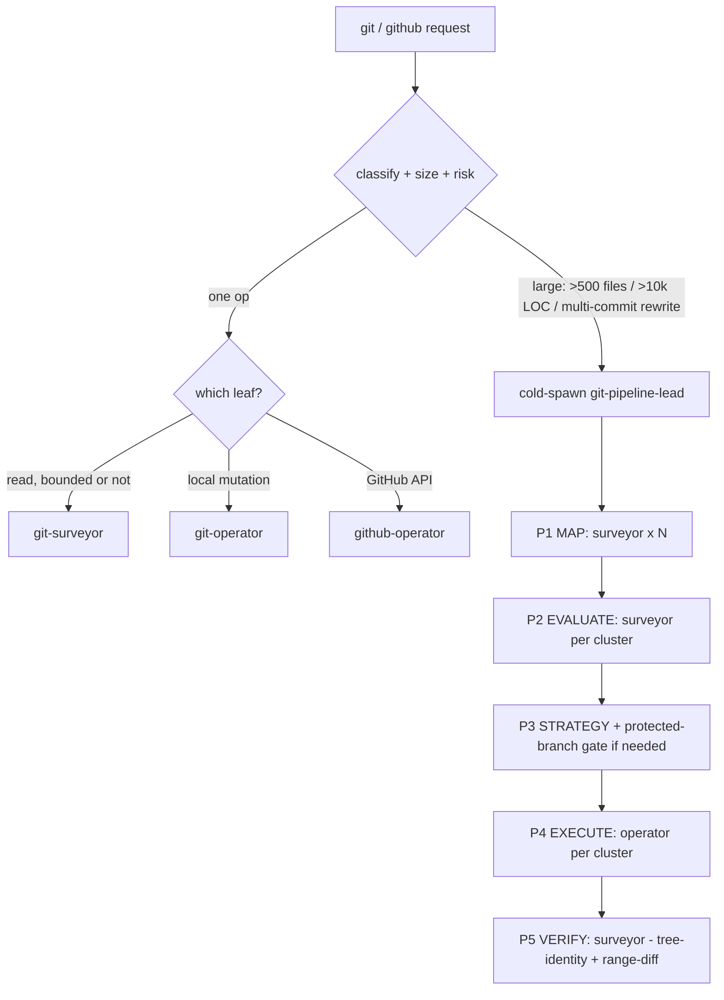
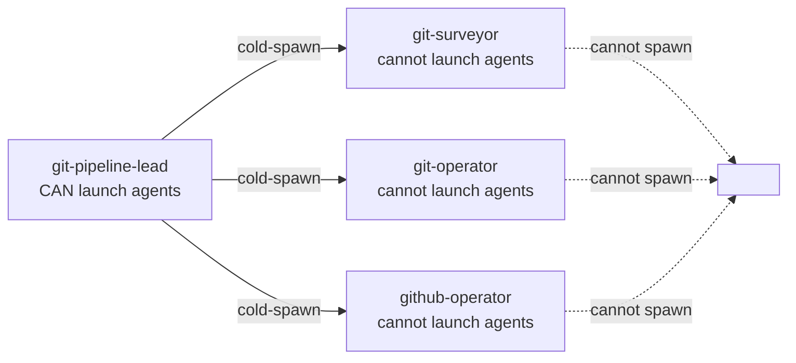
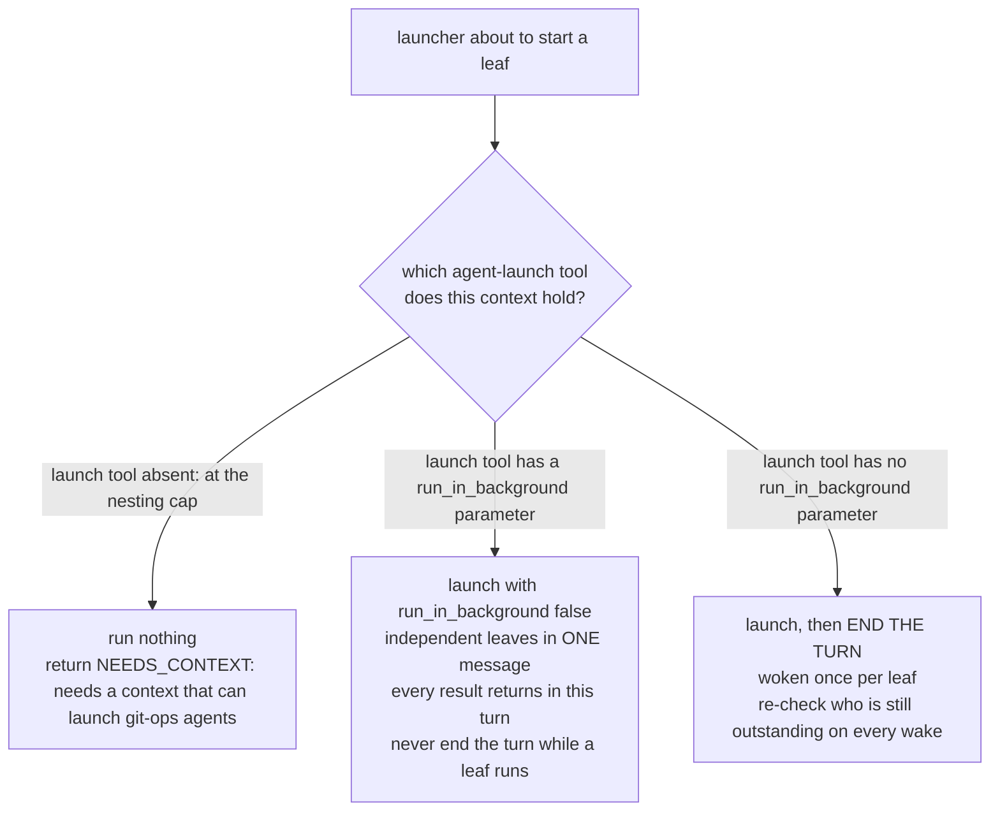
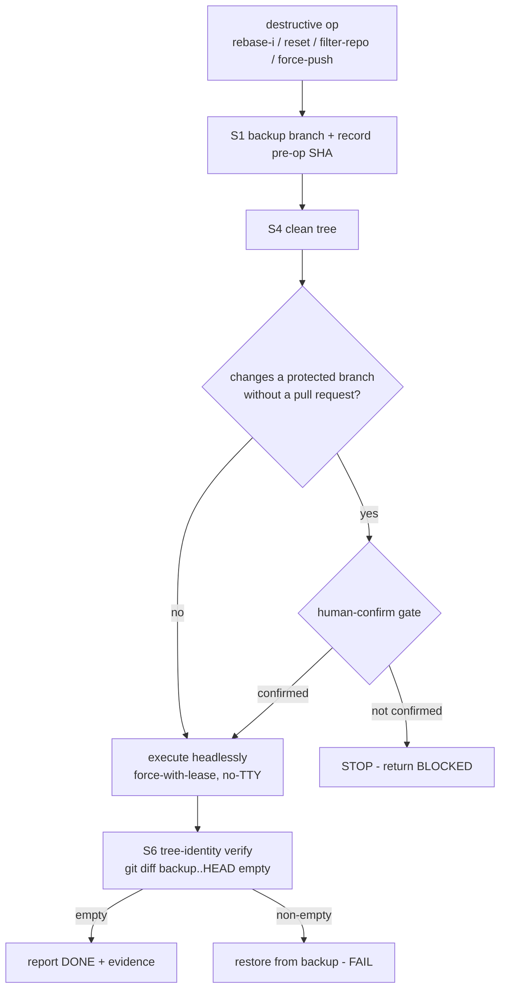

# git-toolkit architecture

`git-toolkit` is a routing + orchestration layer made of Markdown: one front-door skill classifies a
git/github request and hands it to a delegated agent, so the CALLER'S context stays clean and code
is never lost. No application logic - the skill and agents are prose with YAML
frontmatter; the actual work is `git`/`gh`/GitHub-MCP commands the agents issue at runtime.

## Components

- **1 skill - `git-ops`.** The universal front door. Auto-triggers on all git + GitHub intent
  (the user may write in any language; the description is English). Classifies the op, picks the agent
  and its tier, and states the request and the expected result. It holds no command know-how.
- **4 agents.**
  - `git-surveyor` - READ-ONLY cognition (map / evaluate / verify). Tool grant excludes write and
    spawn tools.
  - `git-operator` - local mutation (integration + destructive rewrite) under the safety contract.
    No spawn tool.
  - `github-operator` - GitHub API, MCP-first / gh-fallback. No spawn tool.
  - `git-pipeline-lead` - the BRAIN + ORCHESTRATOR for large changes; the ONLY agent that spawns.
- **11 snippets (SSOT).** safety-contract, scale-protocol, scale-recipes, nesting-protocol,
  delegation-decision, model-tiers, squash-push, github-mcp-first, commit-convention,
  language-mirroring, completion-reporting. Each rule is declared ONCE; the skill and agents POINT at
  it via `${CLAUDE_PLUGIN_ROOT}/snippets/...`, never duplicate it. The rules a dispatcher reads
  (delegation-decision, scale-protocol, model-tiers) state outcomes; command recipes live only in
  files the agents read (scale-recipes, squash-push, the references).
- **6 references.** large-change-pipeline (cited by `git-pipeline-lead`), history-rewrite and
  conflict-resolution (`git-operator`), github-pipeline (`github-operator`), and the two
  commit-convention standards (general, odoo, loaded by the detection protocol) - deterministic
  recipes the agents load on demand. The skill cites none of them.

## Routing (the skill decides)

The caller's brief states the request and the expected result, never git or gh commands; the agent
chosen below owns the commands, the flags and the safety steps.

## Depth guard (anti-runaway)

Only `git-pipeline-lead` holds the spawn tool; the three leaves declare a `tools:` allowlist that
excludes it, hard-capping nesting at two levels (lead -> leaf).

**Launch and collect (N0).** A launcher - the lead, or the context a `git-ops` skill runs in - reads
its own agent-launch tool before launching, and that tool alone decides how it collects a result:

A launch that still hands back an asynchronous receipt while the parameter is held is waited out
inside the same turn with tool calls, never by ending the turn. Cold-spawn (stateless brief in,
findings file out) is the DEFAULT and always-correct baseline - robust at any caller depth, no roster
needed. Every agent hands its completion report back once, as the last act of its dispatch, per
`${CLAUDE_PLUGIN_ROOT}/snippets/completion-reporting.md` - there is no addressed upward channel, so
the leaves' allowlists grant no messaging tool at all and cannot fan out.

## Safety gate (destructive ops)

## Consuming this toolkit

`git-toolkit` is a provider library; it does not know its consumers by name. An orchestrating
CALLER - any skill, agent, or pipeline that needs git/GitHub work done - delegates every git read, local
git mutation and GitHub API op to these agents through the `git-ops` skill, describing the request
and the expected result (never commands), rather than running git itself. The caller is
responsible for:

- Worktree isolation per mutation - never operate on the primary/shared checkout (S9 in
  `${CLAUDE_PLUGIN_ROOT}/snippets/git-safety-contract.md`).
- Human-confirm for the one gated op - a change to a protected branch without a pull request:
  obtain confirmation and pass it through to the operator (the gate in the same snippet).
- Compact returns - ingest the worker's summary + findings path, never the raw diff
  (`${CLAUDE_PLUGIN_ROOT}/snippets/git-delegation-decision.md`).

Leaf-workers the caller spawns into a worktree are restricted to that worktree and must not issue
git commands themselves; all integration and history mutation flows through git-toolkit's agents.

How a specific consumer adopts this contract belongs in that consumer's own documentation and is
intentionally out of scope here.

## Dependency

`git-toolkit` declares `"dependencies": ["github"]`. The `github` plugin (default
`claude-plugins-official` marketplace) auto-installs and provides the
`mcp__plugin_github_github__*` tool surface. It authenticates with `GITHUB_PERSONAL_ACCESS_TOKEN`;
when that is absent, `github-operator` falls back to the `gh` CLI (its own auth). See
`${CLAUDE_PLUGIN_ROOT}/snippets/github-mcp-first.md`.
