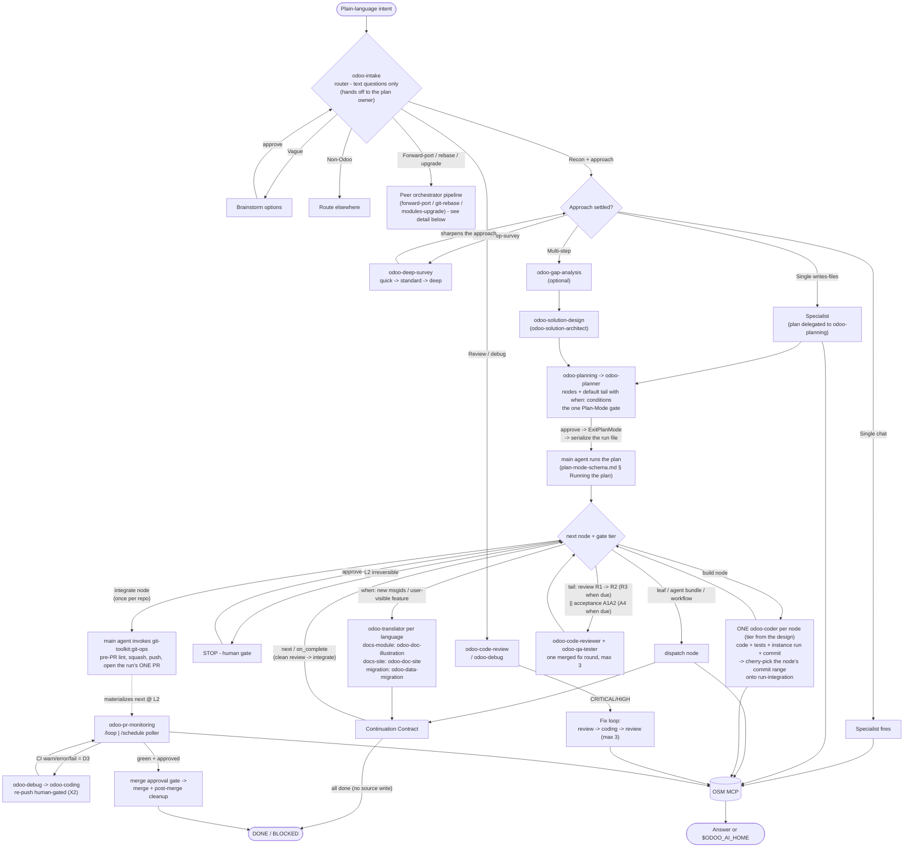
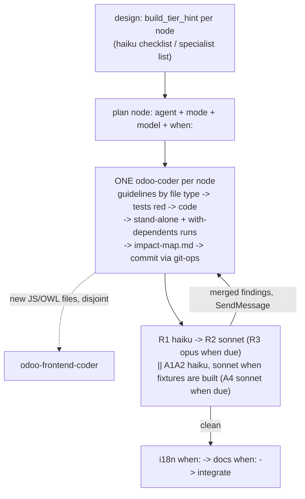
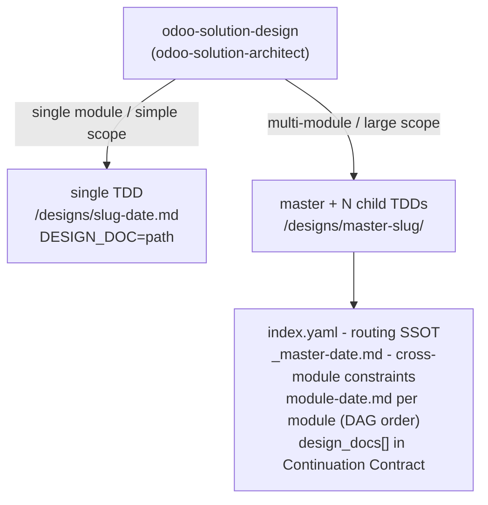
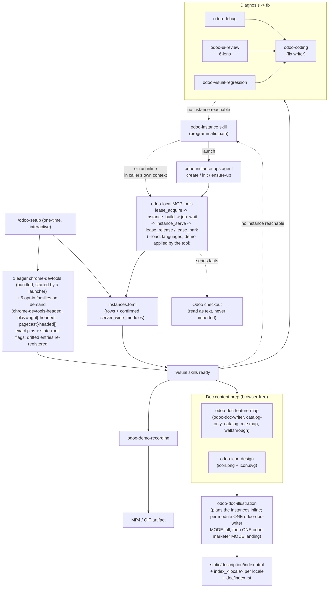
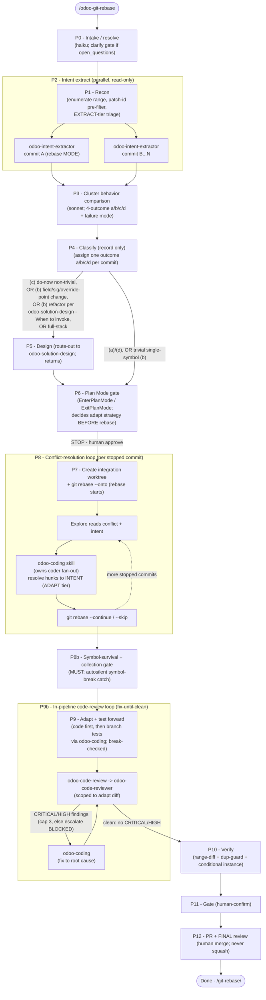
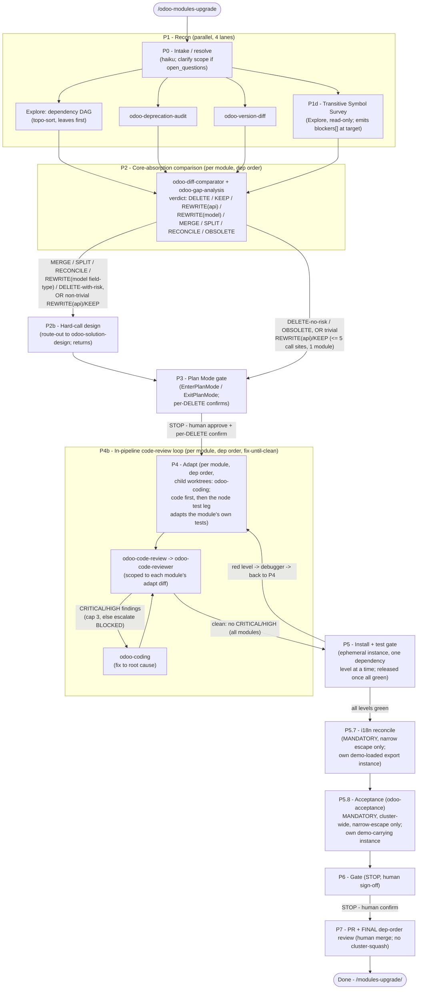
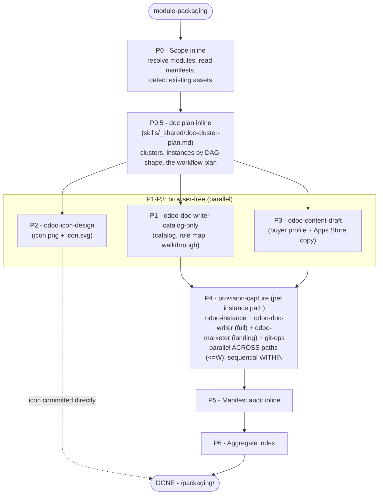
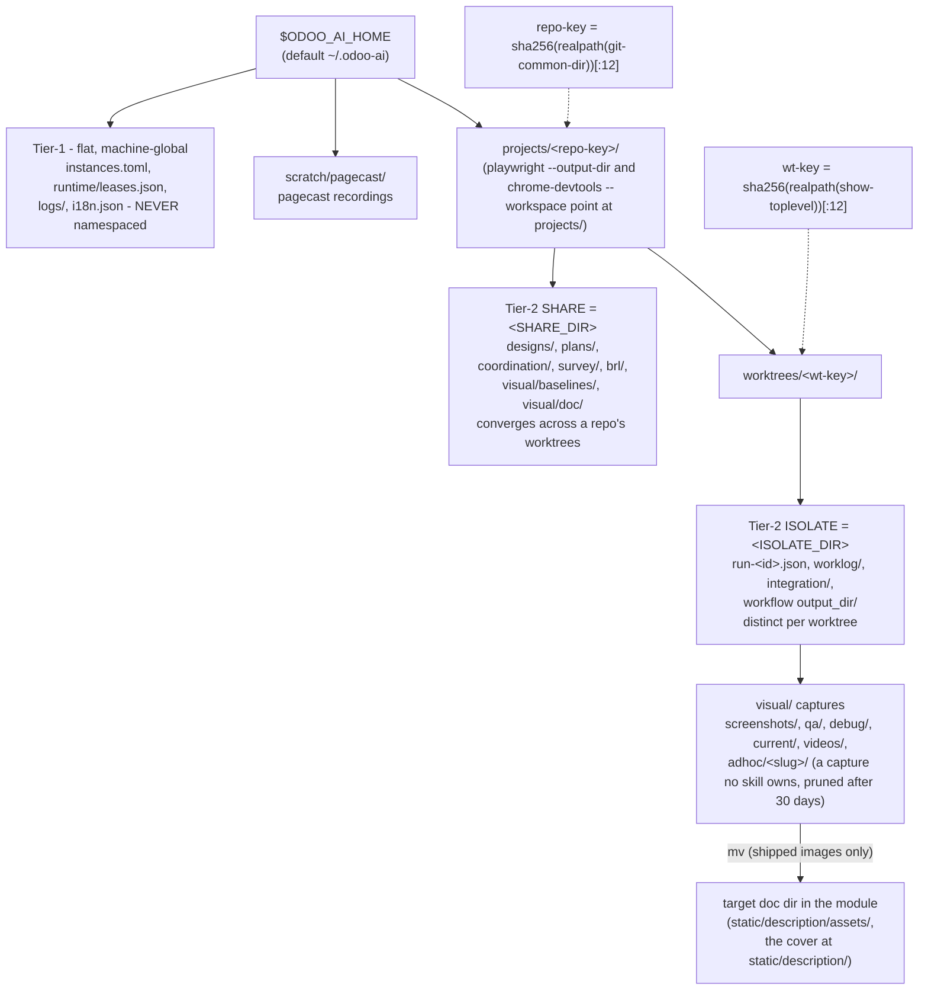

# Odoo AI Agent Team

> Plugin slug: `odoo-ai-agents`

[](../../LICENSE)
[](https://odoo-semantic.viindoo.com/)

> The Odoo AI workforce toolkit: **50 skills + 21 agents + 8 commands**, grouped into **9 persona
> buckets**, plus **13 declarative workflows** - covering engineering, coding, code review, visual
> UI testing, instance provisioning, pre-sales, sales, marketing, strategy, onboarding, and cross-version forward-porting. Installing this plugin pulls
> in the companion [`odoo-semantic-mcp`](../odoo-semantic-mcp/) plugin automatically (declared
> dependency), so all knowledge is grounded through the OSM MCP server. This plugin is a routing
> and orchestration layer; Odoo knowledge lives on the server. The one local runtime it ships is
> the instance allocator and the `odoo-local` MCP server over it (below), which provision and
> tear down Odoo instances on your machine.

## What you get

Nine virtual specialists that self-activate from plain-language intent - no slash
commands to memorize. Describe what you need; the right persona fires automatically.
You do not need to know skill names.

`odoo-intake` is the universal front door. Say what you want in plain language and it plans the
whole job once, then drives it to done:
- **Vague intent** -> it brainstorms with you (clarifying options, no open-ended "what do you want?").
- **Clear single-step intent** -> it fast-paths straight to the matching specialist. A **review,
  PR-review, or debug** intent fast-paths to `odoo-code-review` / `odoo-debug` - and on a CRITICAL/HIGH finding that specialist **autonomously drives the fix** through
  `odoo-coding` and re-reviews to verify (review -> code -> review, bounded to 3 rounds then escalates).
- **Large / open-ended job** -> it can offer an opt-in **deep survey**, which you ask for by
  replying `refine: deep-survey` to its approach question: a read-only, multi-phase
  pass (broad quick sweep -> narrow standard-depth dives -> optional deep pass) that writes a synthesis under
  `<SHARE_DIR>/survey/` (resolve `<SHARE_DIR>`/`<ISOLATE_DIR>` once per `${CLAUDE_PLUGIN_ROOT}/snippets/state-root-resolution.md`; substitute the captured absolute path - never write the placeholder or a bare `.odoo-ai/` into a Read/Write/Edit) and re-informs a sharper plan before any code is written.
- **Multi-step intent** -> it lays out a plan (the modules, their order, who does each), you
  approve once, and then it **advances step-to-step on its own** - dispatching each specialist,
  reading the result, and moving to the next - stopping only when a step is irreversible/outward
  (e.g. a git push or an email to a customer) or when it is blocked and needs you.

You control how hands-off this is with one optional flag (`--auto` is the default; see
[Drive to done](#drive-to-done-how-to-use-it)). No execution ever fires before you approve the
plan, and the main agent is never forced or trapped - the stops are real human checkpoints, the
nudges are advisory.

A first-class **forward-port pipeline** (`/odoo-forward-port`) is also included: a 13-phase
orchestration (P0-P12, with a mandatory P9.5 i18n sub-phase) that groups commits by MODULE first,
then by commit within it, and ports them across Odoo series using intent-first extraction (not raw
code carry-over), merge-keep-SHA strategy, symbol-survival checking, pre-adapt drift scan, adaptive
test forwarding, and verify-by-behavior per batch - at most one agent instance per module across
the whole run. It runs alongside coding, code review, and upgrade planning as a core engineering
capability.

> **Counts at a glance:** this plugin ships **50 skills + 21 agents + 8 commands**, grouped into
> **9 persona buckets** for navigation, plus **13 declarative workflows** driven by
> `workflows/*.workflow.yaml`. A further slash command, `/odoo-semantic-mcp:connect`, belongs to
> the companion `odoo-semantic-mcp` plugin and is pulled in automatically when you install this one.

## Who is it for

The `Domain` column cross-references the `domain` enum in `workflows/_schema.md` §3 (the
technical SSOT `hooks/detect-intent.sh` and every `*.workflow.yaml` classify against) - several
personas share one domain value where the underlying work is the same discipline (Engineer /
Coder / Code-Reviewer all `engineering`); `qa` and `support` are workflow-level domain values
(`qa-suite.workflow.yaml`, `support-triage.workflow.yaml`) without a dedicated top-level persona
row above.

| Persona | Domain | Key skills |
|---------|--------|-----------|
| Onboarding / Concierge | consultant | `odoo-intake` |
| Engineer | engineering | override-finding - deprecation-audit - forward-port / version-diff - git-rebase - modules-upgrade |
| Coder | engineering | odoo-coding - odoo-debug - solution-design |
| Code-Reviewer | engineering | odoo-code-review |
| Visual / UI QA | qa | ui-review - visual-regression - demo-recording - doc-illustration |
| Pre-Sales | presales | feature-check - gap-analysis - brl |
| Sales AE | sales | objection-handling - deal-followup - discovery-summary |
| Marketer | marketing | feature-highlights - content-draft - campaign-plan - icon-design - doc-feature-map - doc-site |
| Strategist / CEO | strategy | risk-overview - competitive-brief - customization-inventory |

- **Engineer** - Find the correct override point, audit deprecated API usage before an upgrade, or validate a deployment is safe.
- **Coder** - Write Odoo backend (Python/XML) or frontend (JS/OWL) code that is idiomatic and convention-correct, without looking up every framework rule.
- **Code-Reviewer** - Review pull requests or audit patches for ORM misuse, inheritance anti-patterns, security holes, or N+1 query issues.
- **Visual / UI QA** - Review a live Odoo screen through six lenses (aesthetics, function, stability, accessibility, performance, design-system fidelity), debug a broken render, catch visual regressions, record a demo clip, or run a full QA pipeline (test cases + checklist + bug triage).
- **Pre-Sales Consultant** - Verify feature availability, build a gap matrix, produce evidence for a proposal, compare CE vs EE side-by-side, or classify and cost hundreds of business requirements at scale with the BRL engine.
- **Sales AE** - Get ACA-structured responses to objections, risk-scored follow-up emails for stalled deals, a synthesized prospect profile from discovery notes, or triage an inbound support ticket into a customer-ready resolution draft.
- **Marketer** - Create content around Odoo features - blog posts, slide decks, social copy, multi-channel campaign plans - in marketing-ready language, and package a complete module for the Apps Store (icon, feature catalog, usage walkthroughs, illustrated landing) via `module-packaging`; individual skills: `odoo-doc-illustration`, `odoo-icon-design`, `odoo-doc-feature-map`, `odoo-doc-site` (a product docs site).
- **Strategist / CEO** - Get an executive risk overview of customizations, a structured customization inventory, or a competitor capability snapshot ready for a board or sales response.
- **Onboarding / Concierge** - Cross-cutting for every persona: `odoo-intake` takes ambiguous intent, brainstorms when vague, fast-paths when clear, resolves the Odoo series/profile/scope from your declared instance or checkout, routes to the right workflow or specialist, and always proposes a plan before any execution skill fires.

### How it works

Every agent - the main agent and every custom sub-agent - carries a shared universal **Work Ethos** (12 principles: completeness, root-cause, source-over-description, SSOT, and so on) loaded from `ODOO-AI-ETHOS.md` via a managed `@import` in your global `~/.claude/CLAUDE.md`.

Everything runs through the **main agent**, which acts as an **orchestrator + decision-maker
only** - it routes, decides at gates, and delegates the heavy work to specialists so its own
context stays clean across a long session. Roles: orchestrating context (main agent) ->
dispatched specialist (skill/workflow) -> named-agent interior worker (e.g. `odoo-coder`) or
fan-out leaf-worker. Multi-level nesting is supported up to the platform depth cap
(`CLAUDE_CODE_MAX_SUBAGENT_SPAWN_DEPTH`; its default and how depth is counted: SSOT
`snippets/spawner-completion-contract.md` §R0 move 1) - at the cap the agent-launch tool is silently
removed from the toolset, no error raised; `context: fork` fan-out workers additionally carry a
hard-rules line banning them from dispatching further spawner skills or subagents, on top of that
platform limit. Dispatch is capability-branching, not role-based - read your own toolset before
acting. Where your launch tool has a `run_in_background` parameter, launch with `false` (parallel
launches in one message, results return inside the turn, never end a turn while a teammate runs).
Where it has none, launch and end the turn, and you are woken once per teammate. SSOT
`snippets/spawner-completion-contract.md` §R0. Orchestrator skills that dispatch
worker agents use the **Context-Handoff Protocol (CHP)** -
a 3-tier dispatch optimization (Tier A resume-a-child-you-launched / Tier B fork /
Tier C fresh spawn + worklog) whose SSOT is `snippets/context-handoff-protocol.md`. Resources
are platform-managed.

`odoo-intake` is the front door for any plain-language intent. It (1) closes an intent gate (what /
why / what-done), (2) resolves the Odoo series/profile/module scope from the instance you declared
with `/odoo-setup`, else derives them from the checkout (inline version/profile menu when OSM is
reachable but neither resolves), or asks you for the series + repo path when OSM is down - (3) runs
a quick read-only **recon** to make the routing context-aware, then (4) asks a text question only
while the approach or scope is unsettled and hands the request to the component that owns its
plan. Every request gets exactly ONE Plan-Mode approval, where its concrete execution plan exists:
`odoo-planning`'s execution plan, a self-planning skill's own plan (forward-port, rebase, module
upgrade, a docs page or section plan), or a workflow's plan. Everything before it is a text
question; nothing under an approved plan enters Plan Mode again. From there:

- **Review / PR-review or debug intent** -> **fast-paths** straight to `odoo-code-review` /
  `odoo-debug`.
- **Single clear step** -> the one specialist fires.
- **Opt-in deep survey** (offered on large jobs as a separate question) -> reply
  `refine: deep-survey` and `odoo-deep-survey` fans out a broad quick sweep -> narrow standard-depth
  dives -> an optional deep pass and writes a synthesis
  under `<SHARE_DIR>/survey/` that sharpens the approach before any execution.
- **Multi-step** -> a new feature or a change across modules opens a **design session**:
  `odoo-solution-architect` writes the SRS (roles, outcome, scope, acceptance criteria with
  expected values), launches one read-only `odoo-impact-recon` (haiku) for the dependency and
  blast-radius facts, and writes a light or full design with a build-tier hint per node; you
  approve the SRS and the design as text questions. `odoo-planning` (via `odoo-planner`) turns
  the design into the plan, approved in Plan Mode: a flat DAG of work NODES (`depends_on` edges only), each
  naming the agent, mode and model it launches, followed by the default tail - review R1 then R2
  (R3 for specialist domains), acceptance in parallel, one merged fix round (at most three),
  i18n, migration and docs behind `when:` conditions, then integrate, monitor and the merge gate
  (`skills/odoo-intake/references/plan-mode-schema.md` § Default tail). `odoo-intake` serializes
  the approved plan to a run file (`<ISOLATE_DIR>/run-<id>.json`) and the **main agent runs it**
  per that file's § Running the plan: pick every ready node, evaluate its `when:` with a tool,
  launch its agent at its model (one `odoo-coder` per build node, which writes code and tests,
  runs them on an instance through the `odoo-local` tools and commits), cherry-pick the returned
  commit range onto the one run-level integration branch, resume the same agent with
  `SendMessage` for a fix or a second review round, and open the run's ONE PR per repo through
  `git-toolkit:git-ops` once every node is terminal and the last verification is current. Once a
  PR is open the async poller **`odoo-pr-monitoring`** drives it to merge (watches CI + review;
  any failure routes to `odoo-debug` with the re-push human-gated; the merge approval gate). Under
  the approved plan the only human gates are the merge and any other outward or irreversible
  operation.

Each step carries a **gate tier** that decides what stops for you (see
[Drive to done](#drive-to-done-how-to-use-it)). Skills resolve the Odoo series, profile, and
addons path from the instance you declared with `/odoo-setup`, and derive them from the checkout
when none is declared, so a later skill never re-asks what an earlier one already resolved. Every
skill grounds its answers through the OSM MCP server; output is a direct answer or a file under
the `$ODOO_AI_HOME` state root.



_All agents (main + custom sub-agents) share a universal Work Ethos loaded from `ODOO-AI-ETHOS.md`; built-in Plan/Explore agents skip it by design._

### Drive to done - how to use it

Two dials decide how much the run does on its own and where it stops for you.

**1. Autonomy dial** (optional flag on your `/odoo-intake` request; default `--auto`):

| Flag | Behavior | Use when |
|------|----------|----------|
| `--auto` *(default)* | Drives the whole plan to done; stops only at irreversible/outward steps (**L2**) and when blocked | You want hands-off; you trust the approved plan |
| `--step` | Stops at **every** writes-files step for confirmation | High-stakes work; you want to inspect each change |
| `--plan` | Produces the plan (modules + order) and stops - runs nothing | You just want the plan/estimate |

**2. Gate tiers** - every step is tagged, and the tier (not the dial) is what ultimately decides
a human stop. **L2 always stops for a human; the dial can never lower it.**

| Tier | What it is | Under `--auto` |
|------|-----------|----------------|
| **L0** | Read-only / chat answers | Auto-passes |
| **L1** | Writes internal files under the `$ODOO_AI_HOME` state root (reversible, outside the repo) | Auto-passes |
| **L2** | Outward and irreversible: a push to or deletion of a protected branch, merging a pull request, sending to a customer - **and any source-code write that was not in the approved plan** | **Always stops for you** |

**Best practice.** Start with a plain-language `/odoo-intake "<what you want>"`. Approve the plan once.
Let `--auto` carry the routine steps; you will be stopped exactly at the moments that matter
(anything leaving your machine or touching a customer/instance). Use `--step` when you want to
watch every edit, `--plan` when you only want the map. You never type a skill name.

> **For contributors / AI agents extending this plugin:** the run rules, the default tail, the
> node brief and the `run-<id>.json` schema live in
> [`skills/odoo-intake/references/plan-mode-schema.md`](skills/odoo-intake/references/plan-mode-schema.md);
> the Continuation Contract in [`snippets/continuation-contract.md`](snippets/continuation-contract.md).
> The per-skill orchestration registry (spawn class, output mode, gate tier) is
> [`docs/reference/ORCHESTRATION-MAP.md`](docs/reference/ORCHESTRATION-MAP.md),
> generated from `generator/skill_tool_deps.json`. Read those before changing routing or gates.

### Coding dispatch and model tiers

Every build node of the plan is owned by **one `odoo-coder`** - a full-stack developer agent that
reads the version's coding guidelines by file type, writes the tests from the acceptance criteria
first (red), then the backend and frontend code of the same node, runs the module stand-alone and
with its dependents on an instance through the `odoo-local` tools, records the symbols it changed
in `impact-map.md`, and commits through `git-toolkit:git-ops`. It launches `odoo-frontend-coder`
only for a frontend part with new JS/OWL files disjoint from the backend files, and a second
`odoo-coder` only when a part exceeds one agent's output budget. When review or acceptance finds
a defect, the main agent resumes the same coder with `SendMessage`; it still holds the node's
context.

The node's **model** is chosen at design time, never by size: `haiku` when the design's six-item
checklist holds (scope, rules, values, placement, tests and dependencies all stated), `sonnet` by
default (a rule must be inferred), `opus` when the unit's business function is on the specialist
list (accounting, tax, payroll, localization, legal) or its override chain and dependent counts
reach the thresholds, and `fable` only when the design proposes it and you confirm. The map and
the thresholds live in [`skills/_shared/concurrency-guard.md`](skills/_shared/concurrency-guard.md)
§ Model-tier selection, with the launch economics: a launch is paid for by independence, real
parallelism on disjoint files, an output cap, tool-heavy work at a cheaper tier, or keeping the
main context clean - never by habit. Nodes whose file sets are disjoint run in parallel inside
the same model-weighted budget. The plugin does NOT use the Claude Code Workflow tool (JS) for
codegen - all fan-out is real subagent launches.

The agent frontmatter `model:` is only a default - the dispatch `model` parameter overrides it per
launch. Review runs the same way: `odoo-code-reviewer` at `haiku` for the mechanical pass (R1),
`sonnet` for behaviour and the verdict (R2), `opus` for the specialist pass (R3) when due;
`odoo-qa-tester` at `haiku` for the execution pass (A1A2), at `sonnet` when a scenario's Given
needs a fixture built, and at `sonnet` for the role walk-through (A4).

> **Model aliases follow the provider's current generation.** `haiku`, `sonnet`, `opus` and `fable`
> are family aliases, so each resolves to the newest generation your provider offers. If your
> provider is pinned to an older generation, an operator can raise the floor through Claude Code's
> model environment settings (for example the per-family alias variables and
> `CLAUDE_CODE_SUBAGENT_MODEL`).



### Solution design decomposition

`odoo-solution-design` produces a flat single TDD (one module or simple scope) or a
master + N child TDDs (multi-module or large scope). Consumers resolve artifact paths from
the Continuation Contract - see
[`snippets/master-child-design-contract.md`](snippets/master-child-design-contract.md) for
the full schema and handoff fields.



## Workflows

The plugin ships 13 declarative workflows in `workflows/*.workflow.yaml`. Each workflow is
executed by the generic `workflow-chaining` skill, which reads the YAML and runs the declared
phase sequence after one approval of the workflow plan. Adding a new workflow is a single YAML
file drop - no orchestration code required. A workflow may also declare an `on_complete`
transition (e.g. `qa-suite` -> `odoo-coding` when bugs are found); the plan runner picks
that up and chains the next step across workflows automatically.

| Workflow | Trigger | Output dir |
|----------|---------|------------|
| `odoo-respond-bid` | Full bid / RFP response chain | `<ISOLATE_DIR>/bids/` |
| `odoo-implement-feature` | Requirement to shipped code with a design step (scope -> design -> code -> review) | `<ISOLATE_DIR>/implement/` |
| `odoo-plan-upgrade` | Comprehensive upgrade plan | `<ISOLATE_DIR>/upgrade-plans/` |
| `odoo-position-feature` | Positioning copy for marketing and sales | `<ISOLATE_DIR>/positioning/` |
| `discovery-pipeline` | Synthesize and structure discovery notes | `<ISOLATE_DIR>/discovery/` |
| `qa-suite` | Static release test-plan + QA checklist + bug triage (non-executing; live acceptance/oracle -> `odoo-acceptance`) | `<ISOLATE_DIR>/qa/` |
| `support-triage` | Classify + root-cause + draft resolution for a support ticket | `<ISOLATE_DIR>/support/` |
| `video-produce` | Multi-scene Odoo demo video (storyboard -> record -> narrate per language -> assemble, verified against the YouTube publish profile -> publish to the PR or the YouTube channel) | `<ISOLATE_DIR>/video/` |
| `sales-closing-cycle` | Late-stage sales cycle: objection handling + closing steps | `<ISOLATE_DIR>/sales/` |
| `ui-debug-session` | Resumable multi-turn UI debug with browser evidence | `<ISOLATE_DIR>/debug/` |
| `content-production` | Multi-asset content from a positioning brief | `<ISOLATE_DIR>/content/` |
| `research-multiphase` | Flexible-phase research: broad survey -> deep dives -> synthesis, model tier scaled per phase | `<ISOLATE_DIR>/research/` |
| `module-packaging` | End-to-end: scope -> doc-plan (branch-aware; the workflow plan) -> feature-map/walkthrough/icon/copy fan-out (browser-free, parallel) -> provision-capture per instance-path (incremental, branch-aware) -> manifest-audit; output `<ISOLATE_DIR>/packaging/` | `<ISOLATE_DIR>/packaging/` |

Commands come in two shapes: multi-phase orchestrators that chain several skills in
sequence, and single-step wrappers that run one skill and offer a save step.

| Command | Skill chain | Output |
|---------|------------|--------|
| `/odoo-respond-bid` | discovery-summary -> gap-analysis -> capability-proof -> objection-handling -> assemble | `<ISOLATE_DIR>/bids/` |
| `/odoo-position-feature` | feature-check -> addon-diff -> competitive-brief -> positioning | `<ISOLATE_DIR>/positioning/` |
| `/odoo-plan-upgrade` | risk-overview -> deprecation-audit -> version-diff -> synthesis | `<ISOLATE_DIR>/upgrade-plans/` |
| `/odoo-run-brl` | Classify + cost -> dependency DAG -> RTM + report | `<SHARE_DIR>/brl/` |
| `/odoo-draft-followup` | odoo-deal-followup (single step) | `<ISOLATE_DIR>/followups/` |
| `/odoo-summarize-discovery` | odoo-discovery-summary (single step) | `<ISOLATE_DIR>/discovery/` |
| `/odoo-produce-video` | odoo-demo-recording per scene | `<ISOLATE_DIR>/video/` |

The visual UI testing stack is a sibling cluster, not a linear chain: one `setup` step
provisions the browser environment, then four skills run independently and converge on
`odoo-coding` as the fix writer. When no reachable instance is detected, the visual
skills emit `NEEDS_NEXT -> odoo-instance` so a live instance can be provisioned
programmatically before the visual workflow resumes.



### Forward-port pipeline (`/odoo-forward-port`)

A 13-phase orchestration (P0-P12, with a mandatory P9.5 i18n sub-phase) that groups commits by
MODULE FIRST, then by commit within that module, and ports them across Odoo series using
intent-first extraction (not raw code carry-over), merge-keep-SHA strategy, symbol-survival
checking, pre-adapt drift scan, adaptive test forwarding, and verify-by-behavior per batch. At
most ONE agent instance is dispatched per module across the whole run for intent extraction (P1)
and, once resumed rather than cold-spawned, for code adapt (P8) - a module's whole picture lives
in one context instead of being split across N per-commit dispatches. Two human STOP-gates bound
the automation.

```mermaid
flowchart TD
    START(["/odoo-forward-port"])
    START --> P0["P0 - Recon + triage<br/>(read-only: enumerate commits,<br/>group by MODULE first,<br/>then by commit within it)"]

    subgraph P1_grp["P1 - Intent extract (parallel BY MODULE, read-only;<br/>at most ONE instance per module)"]
        P0 --> IE1["odoo-intent-extractor<br/>module A (its full ordered<br/>commit list, one instance)"]
        P0 --> IE2["odoo-intent-extractor<br/>module B...N (same)"]
    end

    IE1 --> P2["P2 - Classify + installable-probe<br/>(4-outcome bucket via OSM; installable from the<br/>target clean-tip manifest; prober for ambiguous cat-3)"]
    IE2 --> P2

    P2 -->|"bucket (c) complex"| P3["P3 - Design<br/>(route-out to odoo-solution-design;<br/>returns to forward-port)"]
    P3 --> P4_gate
    P2 -->|"bucket (a/b/d)"| P4_gate["P4 - Plan gate<br/>(EnterPlanMode / ExitPlanMode;<br/>plan.md written module-first as resume record)"]
    P4_gate -->|"STOP - human approve"| P5["P5 - Git merge --no-ff --no-commit<br/>(ONCE per batch: the range tip,<br/>keeps every source SHA)"]

    P5 --> P6["P6 - Symbol-survival check<br/>(7 classes: field/method/model/<br/>test-base/import/installable/orm-field-key)<br/>+ test-survival sub-check"]
    P6 --> P7["P7 - Pre-adapt drift scan<br/>(Lane 1: ALL .py - import+pyflakes+orm-field-key<br/>Lane 2: tests-only collect gate)"]

    subgraph P8_grp["P8 - Adapt (code first, then tests;<br/>ONE resumable worker<br/>per module across ALL its commits)"]
        P7 --> PB["adapt code by bucket<br/>a=skip / b=3-way / c=reimplement / d=skip<br/>(odoo-coding -> odoo-coder, resumed<br/>by WORKER_AGENT_ID; COMMIT: caller)"]
        PB --> PA["node test leg, after the code<br/>(odoo-test-writer adapts source tests,<br/>executed break-check;<br/>bucket-a absorption probe)"]
        PA --> PC["i18n compute<br/>(8e records i18n_due; no dispatch here)"]
    end

    PC --> P9["P9 - Verify by behavior<br/>(ephemeral instance, integrated run per batch,<br/>break-check reports carried;<br/>released once P10 concludes the last batch)"]
    P9 --> P95["P9.5 - i18n reconcile<br/>(MANDATORY, narrow escape only;<br/>odoo-i18n builds its OWN demo-loaded<br/>export instance, never the P9 one)"]
    P95 --> P96["P9.6 - migration dir (C2)<br/>(retarget or forward, after P9 is green)"]
    P96 --> P10["P10 - Conclude the merge<br/>(self-decided; ONE commit closes the batch's range;<br/>P5 again only per human-approved batch)"]
    P10 --> P11["P11 - End-to-end acceptance<br/>(odoo-acceptance, on its own demo-carrying<br/>instance) - MANDATORY cluster-wide,<br/>narrow-escape only; runs BEFORE the P12 PR<br/>opens or its review runs"]
    P11 --> P12["P12 - PR + code-review<br/>(mandatory for new engines);<br/>pushes + opens the PR only after P11 acceptance<br/>and this phase's own diff-based review clear"]
    P12 --> DONE(["Done - <ISOLATE_DIR>/forward-port/"])
```



| Phase | Description | Parallel? | Human gate? |
|-------|-------------|-----------|-------------|
| P0 Recon + triage | Enumerate commits; inline-triage model tier; read-only | - | - |
| P1 Intent extract | Group commits by MODULE first (P0), then dispatch ONE odoo-intent-extractor per module - its full ordered commit list in one context, at most one instance per module for the whole run, never one per commit | Yes (N modules) | - |
| P2 Classify + installable-probe | 4-outcome bucket via OSM; installable read from the target clean-tip manifest; odoo-installable-prober for ambiguous cat-3 | Serial per commit | - |
| P3 Design | CONDITIONAL: route-out to odoo-solution-design for complex bucket-(c) modules; returns to forward-port | Serial per commit | - |
| P4 Plan gate | EnterPlanMode / ExitPlanMode; plan.md written module-first (each module's own commit list nested under it) as the resume record after approval | - | STOP - human approve |
| P5 Git merge --no-commit | ONE `git merge --no-ff --no-commit` of the batch's range tip (absorb-all): every source SHA in the range comes with it and the merge window stays open through P10; never one merge per commit | Once per batch | - |
| P6 Symbol-survival check | 7 classes (field/method/model/test-base/import/installable/orm-field-key) + test-survival sub-check | Serial per commit | - |
| P7 Pre-adapt drift scan | Lane 1: ALL .py (import+pyflakes+orm-field-key); Lane 2: tests-only collect gate | Serial per commit | - |
| P8 Adapt | Code first, then tests, per module: adapt code by bucket (a=skip/b=3-way/c=reimplement/d=skip) via `odoo-coding` -> `odoo-coder`, then the node test leg (`odoo-test-writer` adapts the source tests and proves each with an executed break-check; a bucket-(a) commit runs its source test first as an absorption probe - GREEN confirms it is absorbed, a failure on the assertion re-buckets it); the node runs with `COMMIT: caller`, so it makes no commit and the batch's merge window stays open; i18n compute (8e records `i18n_due`, dispatch happens at P9.5); C1 version formula (installable modules only) / C3 source-bug gate | Serial per module (a module touched by several commits is adapted once against the merged result; its coder is launched once and resumed by the id that launch returned) | - |
| P9 Verify by behavior | Ephemeral instance, integrated run per batch carrying each node's break-check report; every batch reuses it, and the pipeline releases it once P10 concludes the last batch | Per-batch | - |
| P9.5 i18n reconcile | MANDATORY per batch for every module whose 8e record says `i18n_due: yes`, narrow escape only; dispatches `odoo-i18n` once, which builds its OWN demo-loaded export instance on the batch worktree - never the P9 test instance, whose database lacks demo terms (non-destructive: existing `.po` loaded before re-export, never blind-regenerate); result presented at P12 | - | - |
| P9.6 Migration dir | Per batch, after P9 is green: each forwarded `migrations/<src-series>.a.b.c/` dir is retargeted when the target has the problem its script solves, else forwarded unchanged (C2); resumes the module's coder | - | - |
| P10 Conclude the merge | Self-decided local merge on `fp/<slug>`: ONE commit (via `git-toolkit:git-ops`) stages the batch's full file list and concludes the merge, closing the whole range; what it records is presented at P12; there is no per-commit P5 loop - P5 runs again only for the next human-approved batch | - | - |
| P11 End-to-end acceptance | Dispatch odoo-acceptance (Skill tool) ONCE for the whole batch, with no instance handle - it provisions its own demo-carrying cluster; MANDATORY, cluster-wide, narrow-escape only; runs BEFORE P12 opens the PR or runs its review (same order as the plan's default tail, `skills/odoo-intake/references/plan-mode-schema.md` § Default tail) | - | L2 (human) - verdict carried into the P12 human-merge decision |
| P12 PR + code-review | Push + open PR only after P11 acceptance and this phase's own diff-based review clear; mandatory code-review for new engines; bot-comment cross-check runs post-PR (the one sub-step that genuinely needs an open PR) | - | STOP - human merges the PR |

### Git-rebase pipeline (`/odoo-git-rebase`)

A 13-phase orchestration (P0-P12, with P8b and P9b sub-phases) that replays commits across Odoo
series using intent-aware conflict resolution, scale-conditional design before Plan Mode, an
in-pipeline code-review-and-fix loop after adapt, and a final pre-merge PR review. Two human
STOP-gates bound the automation; a third automated review gate (P9b) catches defects before verify.



Two review points are visible: the **P9b in-pipeline code-review loop** (fix-until-clean, right
after the adapt, before verify) AND the **P12 final PR review** (pre-merge). This is intentionally
more rigorous than forward-port (PR review only).

| Phase | Description | Parallel? | Human gate? |
|-------|-------------|-----------|-------------|
| P0 Intake / resolve | Clarify gate if open questions; read-only | - | - |
| P1 Recon | Enumerate range; patch-id pre-filter; EXTRACT-tier triage | - | - |
| P2 Intent extract | Dispatch odoo-intent-extractor per commit in rebase MODE | Yes (N commits) | - |
| P3 Cluster behavior comparison | Sonnet; 4-outcome a/b/c/d + failure mode per commit | - | - |
| P4 Classify | Assign one outcome a/b/c/d per commit (record only) | Serial per commit | - |
| P5 Design | CONDITIONAL: route-out to odoo-solution-design when non-trivial (see design-trigger table); returns | Serial per commit | - |
| P6 Plan Mode gate | EnterPlanMode / ExitPlanMode; decides adapt strategy BEFORE rebase starts | - | STOP - human approve |
| P7 Create integration worktree + rebase | Create worktree; git rebase --onto (rebase starts here) | - | - |
| P8 Conflict-resolution loop | Per stopped commit: explore conflict + intent; odoo-coding (owns the coder fan-out) resolves hunks to INTENT; git rebase --continue / --skip | Serial per commit | - |
| P8b Symbol-survival + collection gate | MUST run; autosilent symbol-break catch before test forward | - | - |
| P9 Adapt + test forward | Per touched module `odoo-coding` adapts the code to the new base first, then the node test leg adapts the branch's own tests, each proven by an executed break-check | - | - |
| P9b Code-review loop | In-pipeline: odoo-code-review -> odoo-code-reviewer scoped to adapt diff; fix via odoo-coding on CRITICAL/HIGH; cap 3 iterations; automated fix-until-clean | - | - |
| P10 Verify | Range-diff + dup-guard + conditional instance | - | - |
| P11 Gate | Human-confirm gate | - | STOP - human confirm |
| P12 PR + FINAL review | Open PR; mandatory final code-review before human merge; never squash | - | - |

### Modules-upgrade pipeline (`/odoo-modules-upgrade`)

An 8-phase orchestration (P0-P7, with P1d, P2b, P4b, P5.7, and P5.8 sub-phases) that upgrades custom
Odoo modules (v8-v19) across a major version jump using dependency-ordered absorption,
scale-conditional design before Plan Mode, an in-pipeline per-module code-review-and-fix loop
after adapt, and a final pre-merge dep-order PR review. Two human STOP-gates bound the
automation; a third automated review gate (P4b) catches defects before the install/test pass.



Two review points are visible: the **P4b in-pipeline code-review loop** (per module, dep order,
fix-until-clean, right after the adapt, before the install/test gate) AND the **P7 final dep-order
PR review** (pre-merge). This is intentionally more rigorous than forward-port (PR review only).

| Phase | Description | Parallel? | Human gate? |
|-------|-------------|-----------|-------------|
| P0 Intake / resolve | Clarify scope if open questions; read-only | - | - |
| P1 Recon | Parallel (4 lanes): dependency DAG (topo-sort); odoo-deprecation-audit; odoo-version-diff; P1d transitive-symbol survey | Yes (4 lanes) | - |
| P1d Transitive Symbol Survey | (sub-phase of P1, parallel) Scans cluster for every symbol referencing external/core deps; grounds each at target; emits blockers[] used as preemptive fix list in P4 | Part of P1 | - |
| P2 Core-absorption comparison | odoo-diff-comparator + odoo-gap-analysis per module in dep order; emits verdict per module | Serial per module | - |
| P2b Hard-call design | CONDITIONAL: route-out to odoo-solution-design for MERGE / SPLIT / RECONCILE / REWRITE(model field-type) / DELETE-with-risk and non-trivial REWRITE(api)/KEEP; returns | Serial per module | - |
| P3 Plan Mode gate | EnterPlanMode / ExitPlanMode; per-DELETE confirmation before any file deletion | - | STOP - human approve |
| P4 Adapt | Per module in dep order; child worktrees; odoo-coding adapts the code first, then the node test leg adapts the module's own tests (`MODE: adapt` with the module's `INTENT`, `SOURCE TESTS`, `BROKEN TEST-SYMBOLS`; each proven by an executed break-check); P1d blockers[] prepended as preemptive fix list; manifest bump profile-gated | Serial per module | - |
| P4b Code-review loop | In-pipeline per module dep order: odoo-code-review -> odoo-code-reviewer scoped to each module's adapt diff; fix via odoo-coding on CRITICAL/HIGH; cap 3 iterations per module; automated fix-until-clean | Serial per module | - |
| P5 Install + test gate | Ephemeral instance; one dependency level at a time (no separate framework-validation phase); a test build runs the series' own demo default, applied by `instance_build`; red level loops back to P4 via debugger; released once every level is green - P5.7 and P5.8 never reuse it | Per level | - |
| P5.7 i18n reconcile | MANDATORY for every surviving module, narrow escape only (not gated on content diff - the `.pot`/`.po` tooling changes across a major series regardless); load existing .po into a fresh instance + re-export + git-ops diff-review (never blind-regenerate) | - | - |
| P5.8 Acceptance | Dispatch odoo-acceptance (Skill tool) ONCE for the whole cluster, with no instance handle - it provisions its own demo-carrying cluster; MANDATORY, cluster-wide, narrow-escape only; verdict presented alongside the P6 sign-off | - | L2 (human) - combined with P6 sign-off |
| P6 Gate | Human sign-off after all levels green | - | STOP - human confirm |
| P7 PR + FINAL dep-order review | Open PR; Runbot parity gates + convention-compliance pass; mandatory final dep-order code-review; no cluster-squash (per-module consolidation to 1 clean commit per module allowed) | - | - |

### Module-packaging workflow (`module-packaging`)

End-to-end pipeline that packages a module cluster for the Odoo Apps Store: scope inline, plan the
instances inline by dependency shape (the workflow plan, approved once), browser-free content prep, then one
`odoo-doc-writer` per module on each instance path (incremental, leaf-first, committed per
module), a manifest audit and a run index.



| Phase | Description | Parallel? | Browser? |
|-------|-------------|-----------|----------|
| P0 Scope | Resolve modules, read manifests, detect existing assets | - | - |
| P0.5 doc plan | Inline per `skills/_shared/doc-cluster-plan.md`: clusters, instances by DAG shape, leaf-first order, dedup; the workflow plan, approved once | - | - |
| P1 Catalog + walkthrough | `odoo-doc-feature-map` -> `odoo-doc-writer` (catalog-only): feature-catalog.jsonl, role-map.json, walkthrough.jsonl | fan-out per module | - |
| P2 Icon | `odoo-icon-design` -> icon.png 256x256 + icon.svg, committed via git-toolkit:git-ops | fan-out (independent) | - |
| P3 Copy | `odoo-content-draft` -> buyer profile + Apps Store copy per locale | fan-out per module | - |
| P4 provision-capture | `odoo-instance` + `odoo-doc-writer` (MODE full) then `odoo-marketer` (MODE landing) + `git-ops` per instance path; incremental install leaf-first; one commit per module | across paths (<=W) | yes |
| P5 Manifest audit | Inline: audit `__manifest__.py` store keys; flag drift | - | - |
| P6 Aggregate | Write `<ISOLATE_DIR>/packaging/` index | - | - |

### Available commands

> `/odoo-semantic-mcp:connect` ships in the `odoo-semantic-mcp` plugin and is not counted among the 8 commands of this plugin.

| Command | Purpose | Chained skills |
|---------|---------|----------------|
| `/odoo-respond-bid` | Full bid response chain for RFP/requirements documents, saves to `<ISOLATE_DIR>/bids/` | `odoo-discovery-summary` -> `odoo-gap-analysis` -> `odoo-capability-proof` -> `odoo-objection-handling` |
| `/odoo-draft-followup` | Sales follow-up email saved to `<ISOLATE_DIR>/followups/` | `odoo-deal-followup` |
| `/odoo-summarize-discovery` | Synthesize discovery notes into a structured profile, saves to `<ISOLATE_DIR>/discovery/` | `odoo-discovery-summary` |
| `/odoo-position-feature` | Positioning copy for marketing and sales use, saves to `<ISOLATE_DIR>/positioning/` | `odoo-feature-check` -> `odoo-addon-diff` -> `odoo-competitive-brief` -> positioning copy |
| `/odoo-plan-upgrade` | Comprehensive upgrade plan, saves to `<ISOLATE_DIR>/upgrade-plans/` | `odoo-risk-overview` -> `odoo-deprecation-audit` -> `odoo-version-diff` -> synthesis |
| `/odoo-run-brl` | Bulk requirement-list classification at scale (chunked, resumable), saves to `<SHARE_DIR>/brl/<job-id>/` | `odoo-brl` (sequential-outer-parallel-inner) |
| `/odoo-produce-video` | Multi-scene Odoo demo video (storyboard -> record -> narrate -> assemble; one publish-ready MP4 per language with captions, thumbnail and chapters), saves to `<ISOLATE_DIR>/video/` | `odoo-demo-recording` (per scene) |
| `/odoo-ai-agents:odoo-setup` | One-shot idempotent setup, asked in outcomes (run Odoo locally, rebuild a venv, capture and record, let the AI work without prompts, publish docs and videos) with one plan confirmed once - wires the browser MCP families (one eager `chrome-devtools` + five opt-in) across Claude/Codex/Gemini, installs browser deps, auto-allows tool permissions, discovers + optionally spins up a local Odoo instance, and - when your skill list is too long for Claude Code to show every description (the default budget on a 200k-token window) - offers to raise the listing budget, showing first how many tokens per turn that adds | - |

## Use cases - day in the life

### Use case 1 - Sales AE: stalled deal, draft a follow-up email in 30 seconds

A manufacturing SME prospect has not replied in 21 days after the demo. Pipeline stage is "evaluation." You need a follow-up email tonight to send tomorrow morning.

```
You: "Deal with Customer A stalled 21 days after demo, manufacturing SME evaluating
Odoo vs SAP. At the last meeting they promised technical feedback within the week.
Write a follow-up email."
```

Skill `odoo-deal-followup` fires. Output: risk score (red - warm lead, >14 days no reply), next-best-action ("re-engage with concrete value proof"), and a 4-paragraph follow-up email. To save it: `/odoo-draft-followup` chains the skill and writes to `<ISOLATE_DIR>/followups/customer-a-2026-MM-DD.md`.

### Use case 2 - Pre-Sales: RFP with 15 requirements

A prospect sends an RFP with 15 functional requirements: lot tracking, multi-level approval, reporting, multi-warehouse, customer portal, and more. You need a complete response within 24 hours.

```
You: "/odoo-respond-bid - Customer B (F&B chain, 50 locations), 15 requirements listed below"
```

The command runs a gated workflow: `odoo-discovery-summary` (prospect profile) -> `odoo-gap-analysis` (effort matrix: Standard / Config / Extension / Custom + S/M/L/XL days) -> `odoo-capability-proof` (evidence for covered items) -> `odoo-objection-handling` (2-3 anticipated objections) -> assemble proposal -> save to `<ISOLATE_DIR>/bids/customer-b-2026-MM-DD.md`. You approve the workflow plan once; the phases then run without stopping.

### Use case 3 - Pre-Sales: BRL scoping for a large implementation

A prospect hands you a spreadsheet with 800 business requirements. You need a full implementation cost estimate, dependency ordering, and a requirement traceability matrix (RTM) before the proposal meeting.

```
You: "/odoo-run-brl - Customer C (retail chain), 800 requirements, Odoo 17, VN rates"
```

The BRL engine runs in a chunked pipeline (50 requirements per chunk): 4-way classification (CE / EE / Viindoo / Custom) with OSM evidence per item, deterministic cost lookup (no fabricated numbers), dependency DAG with Kahn topological sort, and phase-by-phase implementation sequencing. Output: `rtm.csv` (Excel-ready RTM), `dag.mermaid` (implementation phases), `cost.json` (project budget roll-up with phase breakdown), and `report.md` (executive summary). The session is fully resumable: if interrupted, re-run the command and it picks up from the last completed chunk.

### Use case 4 - Strategist / founder: monthly board brief

You need a board status brief covering product progress, pipeline health, competitive landscape, and top risks before next week's investor meeting.

```
You: "Summarize competitive landscape - Competitor A vs your Odoo distribution -
for next week's board meeting."
```

Skill `odoo-competitive-brief` fires. It pulls competitor signals from context, the vault, or a web search (you can also supply them inline); the skill structures them into a market snapshot, capability matrix, GTM moves, threat assessment, and recommended product response - ready for a board deck. Combine with `odoo-risk-overview` (founder-level engineering risk dashboard) and `odoo-customization-inventory` (all custom modules with business purpose, M&A due-diligence ready).

### Use case 5 - Engineer + Coder: upgrade v15 to v17

Customer D is running Odoo 15 with 12 custom modules and wants to move to v17 in Q3.

```
You: "/odoo-plan-upgrade - Customer D, v15 to v17, 12 custom modules, deadline Q3"
```

Chains `odoo-risk-overview` -> `odoo-deprecation-audit` -> `odoo-version-diff` -> synthesis. Output: executive risk overview, code-level deprecation findings, API/feature diff, action ordering, S/M/L/XL effort estimate, and rollback plan. Saves to `<ISOLATE_DIR>/upgrade-plans/customer-d-v15-v17-2026-MM-DD.md`. When you need actual code written, invoke the `odoo-coding` skill (it owns the coder fan-out + model tier; OSM access).

### Use case 6 - Marketer: launch a new feature campaign

You just shipped a new inventory forecasting feature and need launch positioning plus ready-to-publish copy for blog, LinkedIn, and email.

```
You: "/odoo-position-feature - inventory forecasting module, target SME manufacturers,
launch window 2 weeks, main competitor SAP Business One"
```

The command chains `odoo-feature-check` (verifies the feature and reads its scope from OSM) -> `odoo-addon-diff` (CE vs EE edition framing) -> `odoo-competitive-brief` (how it lands against SAP B1) -> positioning synthesis. Output: a one-line value proposition, three proof points, objection rebuttals, and channel-by-channel copy. Saves to `<ISOLATE_DIR>/positioning/inventory-forecasting-2026-MM-DD.md`. For a full multi-week campaign blueprint, follow up with `odoo-campaign-plan`; for per-asset drafts (blog, email sequence, social), call `odoo-content-draft`.

### Use case 7 - QA / Visual: catch visual regressions after installing a module

Your team just installed a third-party module and you need to confirm no existing screens broke before handing off to the client.

```
You: "Run visual regression on the invoicing list and form views after installing
module account_followup on Customer E's staging instance."
```

Run `/odoo-ai-agents:odoo-setup` once to provision the browser automation stack. Then skill `odoo-visual-regression` fires: it captures before/after screenshots of targeted views, diffs them, and flags regressions with severity labels. Where a defect is confirmed, `odoo-ui-review` follows up with a 6-lens audit (aesthetics / function / stability / accessibility / performance / design-system + theme fidelity) and surfaces the exact CSS or XML path to fix. Fixes are handed to `odoo-coding`, which writes the override and shows a patch preview before applying.

### Use case 8 - Support: triage an inbound customer ticket

A customer reports that their invoice approval workflow is broken after a recent module update. You need to classify, root-cause, and draft a resolution note in one pass.

```
You: "Customer F reports: invoice approval button disappeared after installing
account_invoice_approval v14. Users are blocked."
```

Skill `odoo-support-triage` fires. It classifies the ticket (bug - UI regression), generates a root-cause hint using OSM to inspect the `account` module's approval flow and the installed module's view overrides, and drafts a resolution note ready to send to the customer. If a live browser is available, it NL-dispatches to `odoo-debug` to capture the console error and pinpoint the broken view. Output saved to `<ISOLATE_DIR>/support/customer-f-2026-MM-DD.md`.

### Frequently asked questions

**I only need one skill - do I have to know all 50?** No. Skills auto-fire by intent match. Describe what you need; the right skill triggers. `odoo-intake` acts as a brainstorm partner when you are not sure which skill to use.

**What if the OSM server is offline?** Each skill has a `## Standalone-first fallback` section - it degrades gracefully by reading your local codebase and your declared instance catalog directly (Read/Grep/WebFetch, three-tier grounding) instead of asking you to paste data; if a browser is genuinely unreachable a visual skill returns BLOCKED rather than requesting screenshots. The plugin does not break when OSM is offline.

**What about confidentiality?** Plugin code is public (MIT). Skills contain no customer-specific data or pricing. A pre-commit hook and CI scan block several categories of sensitive content. Examples use abstract labels (Customer A through Customer F).

**Multi-runtime?** Skills and commands are written for Claude Code. Codex/Gemini parity is smoke-tested in `tests/smoke/runtime_parity.md` - 10 representative skills verified across all three runtimes.

**Why did a coding task run on a bigger (or smaller) model?** The design gives each node a build-tier hint and the plan you approve names the model of every node (haiku / sonnet / opus; fable only on your confirmation). Haiku takes a node whose scope and business rules are already stated; sonnet takes a node whose rule must be inferred. Size and context never escalate the tier. The tier is recorded in `plan.md`. Map and thresholds: [Coding dispatch and model tiers](#coding-dispatch-and-model-tiers).

**How do I add a new workflow?** Drop a `*.workflow.yaml` file in `workflows/` following the schema in `workflows/_schema.md`. The `workflow-chaining` auto-discovers it. No `plugin.json` edit needed.

## Quick install (Claude Code - 3 steps, all required)

Inside Claude Code, run:

```
/plugin marketplace add Viindoo/claude-plugins   # one-time, if not already registered
/plugin install odoo-ai-agents@viindoo-plugins   # auto-pulls odoo-semantic-mcp
/odoo-semantic-mcp:connect
```

Installing `odoo-ai-agents` **automatically pulls in `odoo-semantic-mcp`** via the plugin dependency, so you get the skills, agents, commands, and the MCP connection in one step. Then **restart Claude Code**.

**On first session after install**, a SessionStart hook adds a managed `@import` block of `ODOO-AI-ETHOS.md` to your **global `~/.claude/CLAUDE.md`**. Because CLAUDE.md is loaded by every Claude Code session (and `@import` is resolved recursively), these principles apply to **all your Claude Code projects**, not only Odoo work. The current session gets coverage immediately via `additionalContext`; subsequent sessions load the file through the `@import`.

- **Dev checkouts:** a `--plugin-dir` dev checkout never repoints an existing import whose target file still exists; only the installed (marketplace) plugin heals the path.
- **Opt out:** set `ODOO_AI_NO_ETHOS_IMPORT=1` before starting Claude Code (dedicated var - independent of `ODOO_AI_NO_AUTO_PERMS`).
- **Uninstall cleanup:** removing the plugin leaves an orphan `@import` block in `~/.claude/CLAUDE.md`. To fully remove it, delete the sentinel-marked block between `<!-- BEGIN odoo-ai-agents ETHOS import ... -->` and `<!-- END odoo-ai-agents ETHOS import -->` from `~/.claude/CLAUDE.md` manually.

You will need an **API key** (format `osm_...`) from the [install page](https://odoo-semantic.viindoo.com/install/), and the **MCP server URL** (default `https://odoo-semantic.viindoo.com/mcp`). For MCP-only setup and the `connect` command details, see the companion [`odoo-semantic-mcp`](../odoo-semantic-mcp/) plugin.

### Browser MCP servers / cross-CLI install

The four Visual skills (`odoo-ui-review`, `odoo-visual-regression`,
`odoo-demo-recording`, `odoo-doc-illustration`) drive a rendered Odoo screen in a live browser.
Only ONE family is **eager**: the headless `chrome-devtools`, bundled natively per runtime and
auto-loaded. The other five families (`chrome-devtools-headed`, `playwright[-headed]`,
`pagecast[-headed]`) are **opt-in** so a plain session never launches browser processes it does
not need - `/odoo-ai-agents:odoo-setup browser` wires them on demand.

Every family runs an **exact package version** (never `@latest`, never a major range, so file-write
rules cannot differ between machines) and is started with flags that make its captures land under
the plugin's state root (`$ODOO_AI_HOME/projects`, the ancestor of every `<SHARE_DIR>` and
`<ISOLATE_DIR>`):

| Family | State-root setting | Also |
|--------|--------------------|------|
| `chrome-devtools[-headed]` | `--workspace=<state root>/projects` (one more per `$ODOO_AI_PROJECT_DIR` / `$ODOO_AI_WORKTREE_DIR` override outside it) | the bundled copy is started by `scripts/mcp/browser_mcp_launch.py` (`python3`), which resolves the state root at every launch |
| `playwright[-headed]` | `--output-dir=<state root>/projects` | `--idle-timeout` closes a browser nobody drives |
| `pagecast[-headed]` | recording directory `<state root>/scratch/pagecast`, set in the registration's environment | runs with a pinned `playwright`; setup installs that same version's Chromium |

Captures are written to the run's `<ISOLATE_DIR>` (`visual/...`; a capture no skill owns goes to
`visual/adhoc/<slug>/`, pruned after 30 days). An image a module doc uses is then `mv`d to where the
doc resolves it. A **PreToolUse hook** refuses a capture whose destination is relative or outside
the capture area, because a relative path would land in your repository. It refuses only when the
answering server provably carries its state-root flag; a server you have not re-registered yet gets
an advisory instead.

**Auto mode.** `/odoo-ai-agents:odoo-setup auto-mode` derives the trusted roots, organization, fork
owner and protected branches from your catalog and git remotes and, on one approval, writes tagged
`autoMode` and `permissions.ask` entries into your user settings, so routine development is never
classified as destructive and the one human gate left is a push to a protected branch or a
pull-request merge. A SessionStart hook keeps those entries current after a plugin update and never
touches entries you wrote yourself.

**Upgrading from an earlier version.** Claude Code runs nothing of a plugin when it is updated; the
first thing of this plugin that starts on the new version is its `odoo-media` MCP server, at
`/reload-plugins` or at the next session. That server runs a one-time upgrade pass (stamped per
plugin version in the state root): values an earlier version read from your shell environment
(`speech.toml` `api_key_env`, `youtube.toml` `*_env`) move into the plugin's configured options
through `claude plugin configure --values-stdin`, the two files are rewritten in the current form
(backups kept), a stand-alone `odoo-semantic` registration left by an earlier `/odoo-semantic-mcp:connect`
moves into `odoo-semantic-mcp`'s options and is removed (once that plugin is updated too), and the
moved values already work in that session. The next session start prints a one-line summary once; a value the pass could not find
(your shell did not export it) is named there and goes in the plugin dialog. When an update adds a
plugin MCP server, `/reload-plugins` may ask for `--force` or a new session. The same pass is a
command you can run yourself: `python3 <plugin>/scripts/lib/upgrade_values.py apply` and
`python3 <odoo-semantic-mcp plugin>/scripts/migrate_connection.py apply`.

**After updating the plugin, re-run `/odoo-ai-agents:odoo-setup browser` and start a new session**
(the browser families are registered in your user configuration, not by the plugin, so they load
at the next session; the plugin's own servers reload with `/reload-plugins`). Setup replaces any registration that differs from what it would write
today (older pin, missing flag, moved `$ODOO_AI_HOME`). On Claude Code a SessionStart hint
(`browser MCP flags outdated`) tells you when this is due; Codex and Gemini get no such hint, so
re-run it by hand after every update.

| Runtime | How the eager `chrome-devtools` ships | What to run |
|---------|-------------|-------------|
| **Claude Code** | Bundled `.mcp.json` (auto-loaded on plugin install; eager `chrome-devtools` only). Started by `scripts/mcp/browser_mcp_launch.py`, so it carries the state-root flag with no manual step. | Nothing extra after `claude plugin install`; run `/odoo-ai-agents:odoo-setup browser` to wire the five opt-in families (and again after every update). |
| **Gemini CLI** | `gemini-extension.json` in the plugin directory (eager `chrome-devtools` only). **Gemini requires a repo root**, so install via local path: `gemini extensions install <your-clone>/plugins/odoo-ai-agents` (or `...link ...` for live dev). Started through the same `python3` launcher. Dedup is by server name. The `trust` field is not allowed in the extension manifest. | `gemini extensions install <your-clone>/plugins/odoo-ai-agents`, then `/odoo-ai-agents:odoo-setup browser` |
| **Codex CLI** | `.codex-plugin/plugin.json` (eager `chrome-devtools` only). Installed from a marketplace snapshot: `codex plugin marketplace add <marketplace>` then `codex plugin add odoo-ai-agents@<marketplace>` (marketplace.json to be published separately). The bundled entry is pinned but carries no state-root flag. | `codex plugin add odoo-ai-agents@<marketplace>`, then `/odoo-ai-agents:odoo-setup browser` |

**Opt-out (browser-free host).** To also stop the eager `chrome-devtools` from loading, add
`"disabledMcpjsonServers": ["chrome-devtools"]` to your Claude settings (`~/.claude/settings.json`)
and simply do not run the opt-in wiring.

**Fallback (Codex/Gemini without native install):** run `/odoo-ai-agents:odoo-setup runtime`
inside Claude Code - it writes all six browser families, with this machine's state-root flags, into
Codex and Gemini idempotently (and replaces a drifted entry). It does **not** write to `~/.claude.json` for Claude Code (served by the
bundled `.mcp.json`).

Full details and manual snippets: [`docs/setup.md` - Visual stack / browser MCP setup](docs/setup.md#visual-stack--browser-mcp-setup).

### Local instance tools (`odoo-local`) and media tools (`odoo-media`)

The bundled `.mcp.json` also registers `odoo-media`, the server that holds the values you configure
through the plugin's dialog (`/plugin` > odoo-ai-agents > Configure: the speech endpoint's value, the
YouTube OAuth client and one refresh token per channel) and runs narration speech and YouTube
publishing with them (`media_info`, `speech_*`, `youtube_*` - `docs/reference/MEDIA-SERVER-API.md`);
nothing outside that server ever sees a value. And `odoo-local`, a stdlib-only stdio MCP server that agents use
to lease an isolated database and ports, build and serve an instance, wait on long builds, and
release or park what they hold, and export translation files (`lease_*`, `instance_*` including
`instance_i18n_export`, `job_wait`, `catalog_*`, `db_preflight`, `series_detect`, `project_dir`,
`repo_facts` (branch, HEAD, remote, dirty and in-progress merge/rebase of a repo, so agents run no git), `server_info`). The tools apply every build fact themselves - server-wide modules (`--load`: the
series' core default first + the catalog row's `server_wide_modules`; a call may exclude declared
modules or include extra ones with `server_wide` `{exclude, include}` when the task needs a different
set, while the catalog stays the default for every other call), languages (`en_US` always) and
demo data - reading each series-dependent fact from your own Odoo checkout, so an agent never
composes those flags. One build or export runs on a database at a time. Every Odoo the tools launch
reads a config file they generate, never your `~/.odoorc`. A lease stays protected for as long as the Claude
Code session that acquired it is alive - no heartbeat or TTL to babysit. Acquiring never drops a
database (when ports run out it frees only the ports of provably dead leases); when the session
ends, its running leases are reclaimed (a parked lease keeps its database until its park budget
lapses, and the shared render server is reclaimed only once its server is gone). `lease_gc`
previews by default, and an applying `lease_gc` is never auto-approved. Hooks keep agents honest: a
subagent can neither hand back its report nor finish while a lease it obtained is still live and not
handed off, nor release, park or adopt a lease it did not obtain, and no browser capture can be written to a relative path or outside the capture area (`<state root>/projects`, i.e. the run's ISOLATE/SHARE dirs). A spawner agent can never write production source itself - the gate has no temp-directory exemption, because a worktree under the system temp dir holds real module source - and acquiring a lease with an `--addons-path-override` that drops the checkout's core addons is refused (keep the catalog row's addons_path and replace only the entry covering your repo with your worktree). A build locates the Odoo launcher on the addons path it serves and falls back to the lease's `odoo_root` only when no entry leads to one. It is Claude Code only (it resolves
`${CLAUDE_PLUGIN_ROOT}`); Codex and Gemini use the allocator CLI instead. **After updating the
plugin, restart every Claude Code session on the machine**, so no older allocator keeps working
on the shared lease registry. Tool index, CLI and error codes:
[`docs/reference/INSTANCE-ALLOCATION-API.md`](docs/reference/INSTANCE-ALLOCATION-API.md).

## Renaming - migrating from `odoo-semantic-skills`

This plugin was renamed `odoo-semantic-skills` -> `odoo-ai-agents` (Odoo AI Agent Team).
If you have the old plugin installed, switch over:

    /plugin uninstall odoo-semantic-skills@viindoo-plugins
    /plugin marketplace update viindoo-plugins
    /plugin install odoo-ai-agents@viindoo-plugins     # auto-pulls odoo-semantic-mcp
    /odoo-semantic-mcp:connect

Then restart Claude Code. Your OSM API key + MCP URL are unchanged; the MCP server
(`odoo-semantic`) and sibling plugin (`odoo-semantic-mcp`) are NOT renamed, so anything using
`mcp__odoo-semantic__*` keeps working. After reinstalling, re-run
`/odoo-ai-agents:odoo-setup permissions` to re-allow the bundled browser MCP tools under the
new `mcp__plugin_odoo-ai-agents_*` prefix.

## Reference

### Grounding contracts (SSOT snippets)

There are two distinct loading mechanisms for shared context:

**Global universal principles** (`ODOO-AI-ETHOS.md`) - a single SSOT file containing 12 work-ethic principles (completeness, root-cause analysis, never trusting a description over the source, SSOT, ASCII hyphens, and so on) that apply across all agents and all of your Claude Code projects. A SessionStart hook writes a managed `@import` block to your global `~/.claude/CLAUDE.md`; because `@import` is resolved recursively, the main agent and every custom sub-agent in any project inherit these principles automatically. Built-in Plan/Explore agents skip CLAUDE.md by design and are NOT covered. Edit `ODOO-AI-ETHOS.md` once and all agents pick it up on the next session restart.

**Per-agent snippet contracts** - agents reference `${CLAUDE_PLUGIN_ROOT}/snippets/...` directly in their bodies (edit the snippet once, not each of the agents that consume it):

| Contract | What it enforces |
|----------|------------------|
| `snippets/dispatch-brief.md` | What a spawner puts in the dispatch prompt it hands a specialist agent. Three rules: every field carries a RESOLVED value (never "go read this document"); one dispatch, one KIND of work; and a brief carries WHAT and WHY, never HOW - the caller owns outcome, scope, inputs and boundaries, the agent owns its method, so a step sequence, tool-call chain, domain heuristic, severity rubric or restatement of the agent's own contract never belongs in one. Two consequences: the brief stays on one screen, and it never points at a `SKILL.md` or an `agents/*.md` either - a skill is invoked and an agent launched, neither is read. A skill fanning out ANONYMOUS workers is exempt: they arrive holding nothing. Authoring procedure: `docs/authoring-skills-and-agents.md` § Writing the brief a skill hands an agent it dispatches; gates: `check_orchestration.py` rules 19 `[brief-knowhow]` + 20 `[definition-pointer]` |
| `snippets/project-facts-resolution.md` | The ordered, terminating 5-rung precedence ladder (brief -> declared instance catalog -> checkout -> the request itself -> ask once) every task works to resolve the four project facts - Odoo series, OSM profile, module/addons scope, and instance target - PER FACT, never substituting a default series |
| `snippets/odoo-platform-design-principles.md` | Multi-company (+ branch v17+), generic-before-localization (lift shared behavior out of `l10n_*`), and the standard app-menu shape (root + Reports + Configuration) |
| `snippets/bidirectional-impact.md` | Survey upstream (the `depends` closure) AND downstream (`impact_analysis` dependents), direct + indirect, before touching a module - at design, code, review, and debug time |
| `snippets/demo-data-dynamic.md` | Demo data is time-relative (`relativedelta`) and lives in `demo/`, kept distinct from test fixtures |
| `snippets/code-comment-contract.md` | What a comment or docstring in shipped source may say: default to none, write one only when the WHY is invisible in the code, state what it SERVES rather than what it does, and never address the reviewer (no "this bug pre-existed", process narration, ticket/date/author, or before/after wording). Also bans an UNSHIPPABLE reference - a design doc, survey, worklog, review, QA oracle, plan or evidence file under the run's state dir, an absolute or worktree path, a run id, slug or instance handle - since none of it exists in the repo the code ships in, however authoritative it looked in the brief. Grades a diff in BOTH directions, so surplus is a finding too, and declares precedence over the upstream "document your code" line - a permission, never a docstring quota (consumed by `odoo-coder`, `odoo-frontend-coder`, `odoo-test-writer`, `odoo-code-reviewer`, and both debuggers when they hand a fix to a coder) |
| `snippets/test-sensitivity-contract.md` | Code first, then tests proven by breaking the rule - stated as principles and judgment, not a script: coders write production code and never tests and nothing is committed before the test leg; ONE `odoo-test-writer` per node then writes new tests or adjusts existing ones (expected values from the request, never from the code) and proves each with a real break-check (run unbroken and green, break exactly the guarded rule, watch it fail on an assertion or the business exception, restore the file exactly and confirm it). Covers when no new test is needed (judged from the diff, with examples rather than a closed list; adapt work still owes its tests), why a failure that never reached the rule is a broken measurement and not a red, how to break each change kind, the bounded 3-round loop deciding who is re-launched, and the absorption probe for forward-port commits already absorbed by core |
| `snippets/test-behavior-contract.md` | How a single test is written: assert observable business outcomes, never the implementation; drive the REAL workflow (action methods, `with_user()` not `sudo()` for access, no seeded terminal state); simulate the user with `Form`; never freeze the present (no counts, existence, names, manifest contents) and never assert translated text; keep the test simple, with literal expected values from the business rule |
| `snippets/worklog-contract.md` | Append-only cross-agent decision journal (`<ISOLATE_DIR>/worklog/<run>/<NNN>-<agent>.md`) read at start, appended before every exit including a refusal, so a later phase can look up why an earlier one decided what it did |
| `snippets/state-root-resolution.md` | The `$ODOO_AI_HOME` two-axis state root: Tier-1 flat (machine-global, never namespaced - the lease registry lives here) vs Tier-2 SHARE (`<SHARE_DIR>`, converges across a repo's worktrees) vs Tier-2 ISOLATE (`<ISOLATE_DIR>`, per-worktree); the repo-key/wt-key resolvers; and the mandatory resolve-once-capture-substitute protocol every skill/agent follows before any Read/Write/Edit under a Tier-2 path |
| `snippets/module-doc-references.md` | References inside a module's shipped docs (`doc/*.rst`, `static/description/index*.html`, `README.rst`, manifest `images`): the root of `static/description/` holds only the icon, the pages and the `main_screenshot` cover (first in `images`, shown on the English page), every other shipped image lives directly in `static/description/assets/`, named `<slug>[.<locale>].<ext>` and referenced as `assets/<file>` from a guide and `./assets/<file>` from the store page; a link to another module uses one root-relative store form (never an absolute store URL or a sibling filesystem path), spelled in the snippet; verified by `scripts/lib/doc_refs_check.py`, which also reports orphan images in a whole-module run |
| `snippets/resource-teardown-contract.md` | Who tears down what: a browser page, recording or trace you DROVE is closed by you (the last chrome-devtools page is navigated to `about:blank`); a lease you obtained is released, parked or forwarded by name; browser findings are advisory, lease findings are hard gates |
| `snippets/visual-evidence-lifecycle-contract.md` | The collision-proof slug rule for per-run `visual/` evidence paths, and the retention sweep for every run-scoped ISOLATE subpath; `visual/adhoc/<slug>/` (a capture no skill owns) is pruned by the plugin runtime after 30 days |
| `snippets/odoo-bin-resource-limits.md` | The odoo-bin memory-cap policy for every launch: a version-general `ulimit -Sv` + `--limit-memory-hard` pair (the v12.0 boundary where Odoo's own enforcement begins), the `MemTotal`-derived default (overridable via `ODOO_AI_LIMIT_MEMORY_HARD`), and which limit flags fire on a `--stop-after-init` build vs a long-running listener conf |
| `snippets/context-handoff-protocol.md` | 3-tier agent dispatch optimization (Tier A resume a child you launched, by the id its own launch returned / Tier B `subagent_type: "fork"` / Tier C fresh spawn + worklog); Tier C is the always-correct SSOT fallback; consumed by `odoo-coding`, `odoo-code-review`, `odoo-forward-port`, `odoo-deep-survey`, `odoo-brl`. The `handoff` metadata field (`send-message \| fork \| fresh`) is surfaced per-skill in `docs/reference/ORCHESTRATION-MAP.md` |
| `snippets/new-module-manifest.md` | Greenfield `__manifest__.py` authoring: scaffold-first, preserve commented placeholder keys, and use the short version form (`0.1` / `1.0.0`) - never the series-prefixed `17.0.1.0.0` form on a new module (enforced by `odoo-coder`, `odoo-frontend-coder`, and `odoo-code-reviewer`) |
| `snippets/upg-conventions.md` | Upgrade conventions for every distribution: a major-series upgrade is a code upgrade, the manifest `version` stays unchanged on a code-level upgrade, and pointers for the always-invisible comment and `hr.employee` `groups=` rules (consumed by `odoo-coder`, `odoo-code-reviewer`) |
| `skills/_shared/odoo-module-graph.md` | The Odoo module DAG (from each `__manifest__.py` `depends`); `odoo-planning` is the canonical producer of the node-partitioned result, which `odoo-coding` and the plan runner consume so all dispatch follows `depends_on` order - the module boundary is a property of a node, not a tier of decomposition |

The two-axis state root at a glance (full classification tables + the resolve-capture-substitute
protocol: `snippets/state-root-resolution.md`):



### Skills (50)

Quick-start guides for a curated subset of the personas above live in
[`docs/personas/`](docs/personas/) - see [`docs/setup.md`](docs/setup.md) for exactly which ones
and why; every persona is still served through `odoo-intake` routing and the skill table below
regardless of whether it has a dedicated guide.

| Skill | Persona | Description |
|-------|---------|-------------|
| `odoo-risk-overview` | Strategist / CEO | Executive risk overview of customizations before upgrade |
| `odoo-customization-inventory` | Strategist / CEO | Structured inventory of all custom modules and their business purpose |
| `odoo-competitive-brief` | Strategist | Competitor capability snapshot structured for board or sales response |
| `odoo-override-finding` | Engineer | Find the correct override point and pattern for a method |
| `odoo-deprecation-audit` | Engineer | Audit deprecated API usage for upgrade readiness |
| `odoo-deploy-checklist` | Engineer | Pre-deployment safety checklist covering config, migration, and rollback |
| `odoo-version-diff` | Engineer + Marketer | Categorized diff of API and feature changes between versions |
| `odoo-test-writing` | Engineer | The SSOT test-authoring capability - writes executable `test_*.py` (TransactionCase/Form/HttpCase, tours), JS Hoot/QUnit, and lightweight performance/load tests that protect business behavior, not current code; also a direct user-triggerable front door. Every component that needs a test authored launches the `odoo-test-writer` AGENT, which invokes THIS skill inline for context isolation (tests written after the code in the `odoo-coding` loop and proven by a break-check, durable acceptance tours, and coverage backfill when review flags an unprotected behavior) |
| `odoo-security-audit` | Engineer | Audit code for SQLi / XSS / access-control / CSRF / unsafe deserialization, graded findings |
| `odoo-data-migration` | Engineer | Write pre/post migration scripts + a verification plan (does not execute against an instance) |
| `odoo-i18n` | Engineer / Coder | Dedicated i18n cluster - export the `.pot` template, then each `.po`, from ONE demo-loaded build through the `instance_i18n_export` tool (Odoo's own export format, never rewritten), non-destructively merge into maintained .po translations, dispatch leaf translation for one or more target languages in a single run (no built-in default - resolved from the request, machine-global `$ODOO_AI_HOME/i18n.json`, on-disk `.po` filenames, or the live instance, else `NEEDS_CONTEXT`), and audit cross-module term consistency; the i18n step forward-port and new-module workflows dispatch into |
| `odoo-perf-audit` | Engineer | Audit for N+1 queries, missing prefetch, unindexed domains, compute thrash, with fixes |
| `odoo-git-rebase` | Engineer | Rebase a feature branch onto another branch of the SAME Odoo series, absorbing intent (not code text) via whole-range `git rebase --onto`. |
| `odoo-modules-upgrade` | Engineer | Upgrade a custom module cluster from a lower Odoo major to a higher one (code-level): drop what core now provides, adapt the rest, 1 PR per cluster. |
| `odoo-forward-port` | Engineer | Forward-port fixes/features - code, the docs a module ships, or the pages of a docs-site repository (its docs-site lane) - from a lower Odoo series up to a higher one as an intent-first pipeline, grouped by MODULE first then by commit within it (module-first intent sweep -> 4-outcome classify -> installable probe -> SHA-preserving absorb-all merge (ONE merge of the range tip, ONE merge commit - never one per commit) -> symbol-survival check -> code-first adapt then tests -> verify-by-behavior -> PR); at most one agent instance per module across the whole run for intent extraction and (resumed rather than cold-spawned) code adapt; two human STOP-gates bound the automation |
| `odoo-solution-design` | Architect / Coder | Design the technical solution (approach / data model / override strategy / module structure) into a gate-able design doc BEFORE coding - the analysis-and-design step between requirement scoping and code; supports master-child decomposition for large multi-module scope (slim, paired with agent bundle) |
| `odoo-planning` | Architect / Coder | Turn an APPROVED design into the EXECUTION plan: a flat DAG of nodes (`depends_on` only), each naming the agent, mode and model it launches, plus the default tail with `when:` conditions; one human gate; the main agent runs it |
| `odoo-coding` | Coder | The single coding front door - launches ONE `odoo-coder` per plan node at the model the design chose (haiku / sonnet / opus; fable on confirmation); the coder writes tests and code, runs them on an instance and commits |
| `odoo-frontend-design` | Architect / Coder / Visual | Knowledge-only design-quality expertise for Odoo UI/UX (view-type choice, form hierarchy, density, semantic tokens, website/portal theming); loaded by `odoo-solution-design` and `odoo-coding`, and the bar `odoo-ui-review` rates against (no agent spawn) |
| `odoo-code-review` | Code-Reviewer | Static review of a diff, worktree or PR in three tiers - R1 mechanical (haiku), R2 behaviour and verdict (sonnet), R3 specialist (opus) when due; a later round resumes the same reviewer |
| `odoo-feature-check` | Pre-Sales Consultant | Check if a feature exists in standard CE or EE |
| `odoo-gap-analysis` | Pre-Sales Consultant | Gap matrix of client requirements vs. standard Odoo |
| `odoo-instance` | Engineer / Coder | Front door for all Odoo instance lifecycle operations (create, drop, init, update, run-tests, ensure-up, load-language, status) for any series v8+; launches the haiku `odoo-instance-ops` agent for build, test, serve and export work (inline only for hard leaves, path-incremental loops, quick reads and teardown of the caller's own lease) and relays back structured metadata including db name, log path, ports, `db_port`, lease token, and the owning run id |
| `odoo-capability-proof` | Pre-Sales Consultant | Evidence-based proof that Odoo supports a client requirement |
| `odoo-addon-diff` | Pre-Sales Consultant | Side-by-side CE vs EE feature comparison |
| `odoo-brl` | Pre-Sales Consultant | BRL engine - classify and cost tens-to-thousands of business requirements into a phased RTM with dependency DAG and checkpoint/resume |
| `odoo-rfp-response` | Pre-Sales Consultant | Per-requirement compliance matrix (Yes / Partial / Roadmap / No + evidence) with an executive fit summary |
| `odoo-pricing-proposal` | Sales AE / Pre-Sales | Customer-facing pricing proposal - tier + implementation bands + SLA + terms (rate numbers are AE-filled placeholders) |
| `odoo-customer-health` | Customer Success | Health score + churn-risk signals + upsell opportunities + recommended next-touch for an existing customer |
| `odoo-objection-handling` | Sales AE | ACA-structured responses to capability objections |
| `odoo-deal-followup` | Sales AE | Risk-scored follow-up email for stalled deals with next-best-action |
| `odoo-discovery-summary` | Sales AE | Synthesize discovery session notes into a structured prospect profile |
| `odoo-support-triage` | Sales AE / Support | Parse an inbound support ticket into classification, root-cause hint, and a customer-ready resolution draft |
| `odoo-feature-highlights` | Marketer | Marketing-friendly feature highlights for a version |
| `odoo-content-draft` | Marketer | One piece of marketing content (blog, LinkedIn, YouTube script, email sequence, App-Store landing copy, social caption) through `odoo-marketer`, which verifies every claim and searches earlier drafts first; builds the buyer profile (segment, buying committee, pains, messaging pillars) a landing is written for |
| `odoo-campaign-plan` | Marketer | Multi-channel campaign plan from a positioning brief |
| `odoo-intake` | Onboarding / Concierge | Universal front door - brainstorms when vague, fast-paths a single clear step, resolves the Odoo series/profile/scope from the declared instance or the checkout (inline version/profile menu when OSM is reachable but neither resolves, asks for the series + repo path otherwise), offers an opt-in deep survey on large jobs (the user asks for it with `refine: deep-survey`), and fast-paths review / PR-review and debug intents straight to the specialist (skipping Plan Mode); for multi-step work plans once then serializes a `run-<id>.json` (a flat node DAG) the main agent runs to done; asks only text questions, and hands the request to the owner of its one Plan-Mode approval |
| `odoo-deep-survey` | Onboarding / Concierge (opt-in) | Multi-phase opt-in deep survey - invoked by `odoo-intake` after the user replies `refine: deep-survey` to its approach question; fans out a broad quick sweep -> narrow standard-depth dives -> an optional deep pass, then writes a synthesis under `<SHARE_DIR>/survey/` that re-informs the plan (read-only; spawner-agent, requires orchestrating context) |
| `odoo-ui-review` | Coder / Visual | Six-lens review of a rendered Odoo screen in a live browser (aesthetics, function, stability, accessibility, performance, design-system + theme fidelity); slim, paired with agent bundle |
| `odoo-debug` | Coder | Root-cause a broken behaviour with ONE debugger per incident (backend or UI, sonnet), escalated to opus with the prior findings when a full pass proves no cause, then to fable on confirmation; hands the proven cause to `odoo-coding` |
| `odoo-visual-regression` | Coder / Visual | Screenshot baseline + diff between two Odoo states (before/after upgrade, module install, theme change) with blast-radius assessment |
| `odoo-demo-recording` | Coder / Visual | Record an MP4/GIF screen-capture of a scripted Odoo click-path for a demo, sales walkthrough, or marketing clip |
| `odoo-doc-illustration` | Marketer / Visual | Module docs (the in-module RST user guide and the App Store page) with live screenshots; a `CHANGE` feature list updates only the affected sections and screens - plans the instances of a multi-module package inline, provisions each, launches per module ONE `odoo-doc-writer` (the user guide) then ONE `odoo-marketer` (the App Store page), verifies the references and commits per module |
| `odoo-icon-design` | Marketer / Visual | Generates icon.png (256x256) plus the icon.svg source, in whichever asset formats the target series accepts (resolved by the agent, never assumed from a series here); reads module manifest, picks fitting symbols, produces static/description/icon.png + icon.svg, then verifies and commits the assets via `git-toolkit:git-ops` (self-provisioning a worktree first if dispatched standalone); dispatches `odoo-icon-designer`; standalone-first, no browser. |
| `odoo-doc-feature-map` | Marketer | The three shared doc files of a module (feature catalog, role map, usage walkthrough text) through `odoo-doc-writer` in catalog-only mode; browser-free |
| `odoo-doc-site` | Marketer | Pages of a product documentation site kept in its own repository (Sphinx, one branch and PR per series) from code, with live screenshots in every language; launches `odoo-doc-site-writer`, browser-accepts the served build with `odoo-qa-tester` and opens the PR; porting its pages to a higher series is `odoo-forward-port` |
| `odoo-qa-suite` | Coder / Visual | Static release QA - produce a non-executing release test-plan, a pre-deploy checklist, and bug triage with severity + reproduction steps; the independent acceptance oracle and live execution/adjudication route to `odoo-acceptance` |
| `odoo-acceptance` | Coder / QA | Prove a change on a live instance against the SRS acceptance criteria - `odoo-qa-tester` builds the stand-alone and with-dependents databases, drives every scenario as its role and rules PASS/FAIL/UNVERIFIED on evidence (A1A2, haiku); the role walk-through (A4, sonnet) when due |
| `odoo-pr-monitoring` | Coder / Engineer | Owns the PR lifecycle AFTER the plan's `integrate` node opened the ONE PR per repo: polls CI and review, routes a failure to `odoo-debug` with the re-push human-gated, presents the merge approval gate and runs the post-merge cleanup |
| `workflow-chaining` | Internal | Generic declarative workflow executor - reads `*.workflow.yaml`, presents the workflow plan once and runs its phases; invoked by odoo-intake, not directly by users |

### Agents (21)

| Agent | Model (default) | Role |
|-------|-----------------|------|
| `odoo-coder` | Sonnet *(the node's model from the design: haiku / sonnet / opus)* | Owner of ONE plan node - reads the version guidelines by file type, writes the tests from the acceptance criteria first, writes backend and frontend code, runs the module stand-alone and with its dependents through the `odoo-local` tools, records `impact-map.md`, commits via git-ops; resumed by SendMessage for fixes |
| `odoo-impact-recon` | Haiku | Read-only recon of a change launched once by the design session (or by a coder without a design): upstream closure, dependents, sibling overrides and references, existing features and tests - one row each with its source (worktree or index) |
| `odoo-doc-writer` | Sonnet | The product-documentation writer for the people who use a module - MODE catalog-only (feature catalog, role map, walkthrough; no browser), MODE full (captures the screens, writes the role-based `doc/index.rst` per locale); a `CHANGE` feature list makes full an update of the affected sections only; searches the existing docs first; traces code through `Explore` at haiku and may split chapters or locales to child workers |
| `odoo-marketer` | Sonnet | The marketing writer - MODE landing (the App Store page from the writer's catalog, facts and captures, cover and feature shots, manifest images), MODE copy (one piece for one channel from a buyer profile); verifies every claim against the catalog, OSM or the live UI and searches existing pages and drafts before writing; launches `Explore` at haiku and child workers for a large workload |
| `odoo-doc-site-writer` | Sonnet | Writes one group of pages of a product documentation site from the series' code and the live UI - facts, screenshots per language, RST, images, translation entries; traces code through `Explore` at haiku |
| `odoo-test-writer` | Sonnet | Test author for callers other than the node's coder (acceptance durable tests, coverage fill, adapt mode) - reads `tests.md` of the series, writes red-first, proves each test with a break-check |
| `odoo-solution-architect` | Opus *(fable proposed for a cross-module inheritance-axis change, on confirmation)* | The design session - writes the SRS, launches `odoo-impact-recon`, decides the design depth from the effort and the recon flags, writes the design with a build-tier hint per node; two human gates (SRS, design) |
| `odoo-planner` | Sonnet | Execution-plan author launched by `odoo-planning` for a design with two or more nodes - nodes with agent, mode, model and `when:`, plus the default tail |
| `odoo-code-reviewer` | Sonnet *(R1 haiku, R2 sonnet, R3 opus per launch)* | Three review modes - R1 mechanical checks with file:line and guideline citations, R2 behaviour against the SRS and design plus the merged verdict, R3 specialist (accounting, tax, payroll, localization, deep override chains); a resumed round verifies the fix and classifies acceptance failures |
| `odoo-ui-reviewer` | Sonnet | Agent bundle for visual UI review - drives a live browser through a six-lens audit with screenshot, console, and Lighthouse evidence plus OSM source pointers |
| `odoo-frontend-coder` | Sonnet *(the node's model)* | Launched by `odoo-coder` only for a frontend part with new JS/OWL files disjoint from the backend files; returns its files to the coder |
| `odoo-backend-debugger` | Sonnet | Debug specialist dispatched by `odoo-debug` - root-causes Python/ORM/server runtime failures via the scientific method, OSM-only (no browser); assesses bidirectional impact (could the bug originate upstream? what downstream does the fix touch?) |
| `odoo-ui-debugger` | Sonnet | Debug specialist dispatched by `odoo-debug` - root-causes OWL/JS/QWeb/SCSS runtime failures from live browser evidence + OSM grounding (serial-exclusive browser use); assesses impact along the template / asset-inheritance axis |
| `odoo-intent-extractor` | Sonnet | Read-only pre-analysis specialist. `odoo-forward-port`'s P1 bulk sweep dispatches exactly ONE instance per touched MODULE (never per commit) - the instance reads that module's FULL ordered commit list in one context, extracting each commit's business intent and behavioral contract while catching a same-file double-touch or a later commit reverting an earlier one within the module, before any git merge or adapt work begins; at most one instance per module for the whole run. A single-SHA brief stays valid for a single-commit clarification or a disputed-outcome re-anchor. Also dispatched by `odoo-git-rebase` (P2, per commit in rebase MODE, batched by module above roughly 30 commits) |
| `odoo-installable-prober` | Haiku | Read-only forward-port P2 leaf - reads the orchestrator-written target clean-tip manifest + source manifest-history dump (it runs no git itself) to decide installable:False category-3 outcome for modules where static classify is ambiguous; returns a 2-valued verdict (`installable_false: yes \| no`) with evidence; dispatched by `odoo-forward-port` at P2 for ambiguous cat-3 decisions |
| `odoo-translator` | Sonnet | Leaf translation worker dispatched by `odoo-i18n` (Phase 3) - translates one module (or module-cluster) for one language by re-exporting from a fresh instance with the existing .po loaded, then the skill's git-ops diff-review adjudicates losses (forwards translation MEMORY, never regenerates blind; no polib), translates every empty `msgstr` - leaving it empty where the translation equals the source - while changing nothing in Odoo's export but `msgstr` content, and self-validates with an Odoo `-u` reload through `instance_build`; never destroys existing human translation |
| `odoo-instance-ops` | Haiku | Instance lifecycle specialist launched by the `odoo-instance` skill - provisions, drives, and tears down Odoo instances for any series (v8+) through the `odoo-local` tools, which apply server-wide modules, languages and demo themselves; learns any other version-specific flag at runtime via OSM `cli_help`; creates and drops databases through Odoo ONLY (`odoo_db.py` / `odoo-bin db drop`) - `odoo_db.py` never calls raw `createdb`/`dropdb`/`psql`, and there is no client-side create at all; it drives whichever database API the checkout's own source defines (read from the source text, never from a series number) and says which cause it observed when it cannot; a raw client `dropdb` is reachable solely as the allocator's logged last-resort fallback when the through-Odoo drop is unavailable, over the surface the declared `db_run_mode` names; a leased DB is dropped by releasing its lease (ownership-checked, race-free), never by bare name; returns structured metadata (db name, log path, ports, `db_port`, lease token, owning run id) so callers keep clean context |
| `odoo-icon-designer` | Sonnet | Dispatched by `odoo-icon-design`; reads module manifest and picks fitting symbols, generates icon.png 256x256 + icon.svg into static/description/; standalone-first, no browser. |
| `odoo-diff-comparator` | Sonnet | Read-only: reads a git-diff range and emits a structured business-intent / expected-outcome / acceptance-criteria comparison (rebase: branch vs base; upgrade: custom vs core). |
| `odoo-gap-analyzer` | Sonnet | Gap-analysis leaf dispatched by `odoo-gap-analysis` (one per requirement cluster) - classifies each requirement against standard Odoo (coverage full/partial/none, classification standard/config/extension/custom, effort tier S/M/L/XL) grounded in OSM first and the local checkout as fallback, then writes a machine-readable findings file; read-only on source, does not design or write code |
| `odoo-qa-planner` | Sonnet | Independent acceptance-oracle author - only when the SRS criteria are not concrete scenarios (role, precondition, steps, comparable value) |
| `odoo-qa-tester` | Haiku *(sonnet when a Given needs a fixture built; A4 and DOCS at sonnet)* | A1A2: builds the stand-alone and with-dependents databases, drives every SRS scenario as its role, rules PASS/FAIL/UNVERIFIED by comparing observed and expected values with evidence; A4: uses the new screens as each audience role and reports what the role cannot understand; DOCS: tests a locally served documentation build page by page in every language at a desktop and a mobile viewport |

## Requirements

- **Odoo Semantic MCP server URL** - `https://odoo-semantic.viindoo.com/mcp` (or your self-hosted instance)
- **API key** - format `osm_<alphanumeric>`, obtain from the [install page](https://odoo-semantic.viindoo.com/install/)
- Claude Code with MCP support (v2.1.x or newer)

## For contributors - local dev install

**Prerequisite:** Python 3.12+ (needed by `make setup` / `make test`).

Test changes from a checkout without going through the marketplace:

```bash
claude --plugin-dir ./plugins/odoo-ai-agents   # skills + agents + commands
```

See [`CONTRIBUTING.md`](../../CONTRIBUTING.md) for the full plugin-dev workflow, the release /
SHA-pinning pipeline, and the DCO sign-off requirement.

## Other AI tools

The plugin is Claude Code only. For other tools, paste the matching MCP config - see
[`docs/setup.md`](docs/setup.md) for full per-client walkthroughs (Codex, Gemini, VS Code,
Antigravity, Windsurf, Zed, JetBrains Junie) and `snippets/` for copy-ready configs:

| Tool | Snippet |
|------|---------|
| Cursor | [`snippets/cursor-mcp.json`](snippets/cursor-mcp.json) (server config) + [`snippets/cursor-rules.md`](snippets/cursor-rules.md) (routing rules) |
| ChatGPT Custom GPT | [`snippets/openai-gpt-instructions.md`](snippets/openai-gpt-instructions.md) |
| Google Gemini Gem | [`snippets/gemini-gem-instructions.md`](snippets/gemini-gem-instructions.md) |
| Continue.dev | [`snippets/continue-dev-mcp.yaml`](snippets/continue-dev-mcp.yaml) (MCP server config) |
| JetBrains AI Assistant | [`snippets/jetbrains-mcp-config.md`](snippets/jetbrains-mcp-config.md) (setup guide) |
| VS Code (v1.99+) | [`snippets/vscode-mcp.json`](snippets/vscode-mcp.json) (top-level key is `servers`, not `mcpServers`) |
| Google Antigravity | [`snippets/antigravity-mcp.json`](snippets/antigravity-mcp.json) (uses `serverUrl`, not `url`) |
| Zed | [`snippets/zed-mcp.json`](snippets/zed-mcp.json) (`context_servers` key, native HTTP - older Zed needs the `mcp-remote` proxy) |
| Windsurf | [`snippets/windsurf-mcp.json`](snippets/windsurf-mcp.json) (uses `serverUrl`, not `url`) |
| JetBrains Junie | [`snippets/junie-mcp.json`](snippets/junie-mcp.json) (place in `.junie/mcp/mcp.json` in your project) |

## License

MIT - see [LICENSE](../../LICENSE) and [NOTICE](../../NOTICE). Brand assets are trademarks of
Viindoo Technology JSC and are not covered by the MIT grant. This plugin is part of the
[`odoo-mcp-client`](../../README.md) monorepo.
